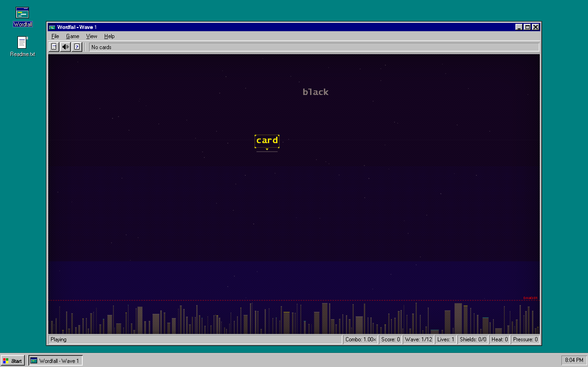
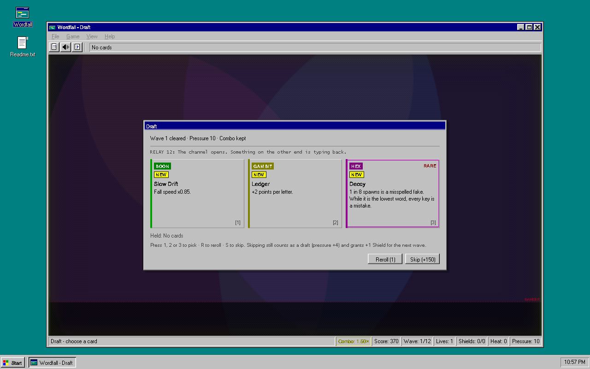
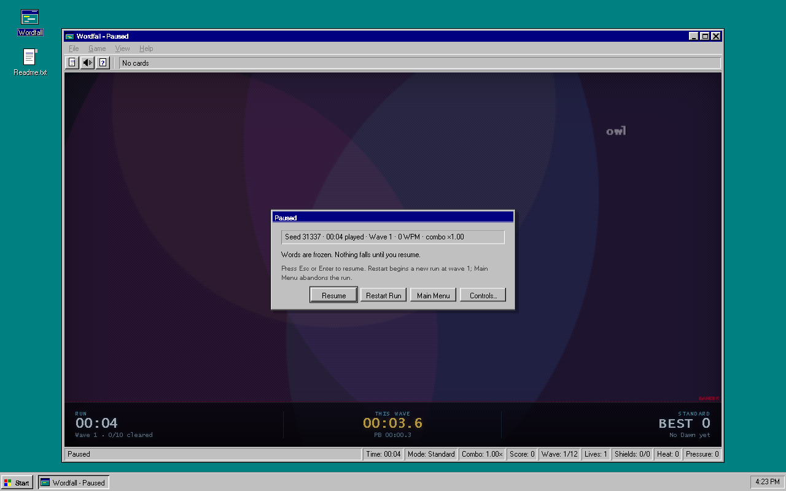

# Wordfall

*Wordfall for Windows* — a one-screen typing game dressed as a 1995 Windows application.
**Read. Commit. Survive.** You may only type the word closest to the ground — everything
else is inert until it becomes a target. Clear ten words and the board freezes for a
draft of one card out of three. Every card bends the rule, the reading, or the economy.
Survive twelve waves to reach Dawn, then keep playing for score.

Design doc: [SPEC.md](SPEC.md). Independent reviews: [QA-REPORT.md](QA-REPORT.md) (v1.0)
and [QA-REPORT-M6.md](QA-REPORT-M6.md) (v1.1).





## What's new in v1.1

- **Pause** — `Esc` freezes the board and the run clock; `Esc` or `Enter` resumes. Also
  Game → Pause/Resume. The pause dialog shows the seed and time played, and offers
  Resume, Restart Run and Controls….
- **Records** — a lifetime records dialog (Game → Records…) for best score, best wave,
  best combo, runs, Dawns, words cleared and fastest Dawn. Kept on this machine in
  `localStorage`; nothing leaves it.
- **Run stats and seeds** — every run has a seed, and the game-over and Dawn dialogs show
  WPM, accuracy, run time and the seed. **Retry Seed** on the game-over dialog replays the
  same seed.
- **Split** — the 13th card (Hex, common): every 5th spawn also drops a real 3–5 letter
  word. It scores, blocks the words above it while it falls, and costs no life at the
  line. Tier II makes it every 3rd spawn.
- Sound on/off is now remembered across launches.

## Run it

**Native Windows app** (recommended) — a borderless Win95-style window hosted in WebView2.
The built app is attached to the GitHub release; `dist/` is build output and is **not**
committed, so from a fresh clone either use the release or build it once with
`win\build.ps1 -Smoke` (see [Native app](#native-app)):

```
dist\Wordfall-win64\Wordfall.exe
```

**In a browser** — shows the full fake desktop (teal wallpaper, icons, taskbar, Start menu)
with the application window in the middle. No build step, no server, no dependencies.
Play the current build at **<https://boci0.github.io/wordfall/>**, or open the file locally:

```
start index.html
```

The game itself is always the same; the native build simply hides the decorative desktop
and fills the window with the app.

## Controls

| Key | Action |
| --- | --- |
| letters | type the target word (the lowest word, or the word you locked onto) |
| Enter | start / retry / continue after Dawn; also resumes while paused |
| Esc | pause a run; while paused, resume (or close a dialog or menu) |
| 1 2 3 | draft: pick the matching card |
| R | draft: reroll the offer (once per run) |
| S | draft: skip (+50 × wave points, still raises Pressure) |
| F2 | new run |

Everything in the window is also clickable: File / Game / View / Help menus, the toolbar,
desktop icon, taskbar button and title-bar buttons (minimize, maximize, close) work in the
browser mock desktop and, for the title bar, in the native build. The Game menu carries
Pause/Resume and Records…; the game-over dialog carries Retry, Retry Seed and Quit.

## How a run works

- **Wave** = 10 clears. When a wave ends the board freezes and a draft opens: slot 1 is a
  Boon, slot 2 anything, slot 3 a Hex or Gambit. Rarity is rolled 75% common / 25% rare.
  Duplicate picks upgrade a card to tier II; cards without a tier II leave the pool.
- **Pressure** = `cleared + 4 × drafts taken` (skips count). Word length, spawn rate and
  fall speed all read Pressure, so skipping does not dodge escalation.
- **Dawn** at the end of wave 12 wins the run; play continues in endless mode, score-only.
- **Lives** start at 1; a word touching the line costs one. **Shields** eat one wrong key
  each (combo kept, no flash) and refill when a wave starts.
- **Heat** = hexes held (tier II counts twice); it multiplies score and keeps rising.
- **Score** = `letters × (10 + Ledger) × combo × heat × Greed × Longshot`, rounded.
- **Wide Scope** widens the target set; the first correct letter **locks on** to one word
  and holds until it is cleared. **Decoy** fakes are misspelled and cannot be typed —
  they drop through fast and are harmless, but while a fake is the lowest word every key
  is a mistake. **Split** drops an extra real 3–5 letter word every 5th spawn (every 3rd
  at tier II); it scores and blocks the words above it, but costs no life at the line.
- **Pause** (`Esc`, Game → Pause) freezes the words and the run clock; `Esc` or `Enter`, or
  Game → Resume, continues. The pause dialog shows `Seed N · MM:SS played`. Minimizing
  auto-pauses, and restoring resumes only that minimize-induced pause — not a pause you
  asked for.
- **Run stats** — the game-over and Dawn dialogs show wave, words cleared, best combo,
  WPM (`correct letters / 5` per minute of playing time), accuracy (correct vs wrong keys,
  shields included), run time and the seed. **Retry Seed** replays the same seed.
- **Records** — lifetime best score / wave / combo, runs, Dawns, words cleared and fastest
  Dawn, kept in `localStorage` (`wordfall.records`) on this machine. Open with
  Game → Records…; sound on/off is stored in `wordfall.settings`.

## Files

| File | Purpose |
| --- | --- |
| `index.html` | the Win95 desktop + application markup (title bar, menus, toolbar, dialogs, status bar, taskbar) |
| `style.css` | the Windows 95 theme: 16-colour palette, 2px bevels, Tahoma/Microsoft Sans Serif, no gradients or blur |
| `words.js` | 459-word pool (`window.WORDFALL_WORDS`), lengths 3–11 |
| `game.js` | the game — config, state, rules, cards, the pixel playfield renderer, audio, DOM UI wiring, headless sim, debug hook |
| `win/` | native Windows shell: .NET 10 WinForms + WebView2, embeds the web files, borderless Win95 chrome |
| `win/build.ps1` | one-command build/publish (`-Smoke` also runs the published exe's self-test) |
| `install.ps1` | copies the build into `%LOCALAPPDATA%\Programs\Wordfall` and (re)creates the desktop shortcut |
| `dist/Wordfall-win64/` | published native app (`Wordfall.exe`), regenerated by `win/build.ps1`; gitignored, not in the repo |
| `SPEC.md` | design doc, cards, milestones, tuning targets |
| `tools/smoke.mjs` | Playwright smoke test — drives the real UI and asserts M1–M6 rules |
| `tools/bot.mjs` | headless WPM bot — asserts the SPEC M5 balance targets |
| `shots/` | screenshots written by the smoke test |
| `QA-REPORT.md` | independent acceptance review of v1.0 |
| `QA-REPORT-M6.md` | independent acceptance review of v1.1 / M6 |

### Presentation notes

- The playfield is a canvas in a fixed **800-unit-tall logical space**, uniformly scaled to
  whatever the window gives. Fall times and difficulty stay identical at any window size.
- Everything around the playfield is ordinary DOM/CSS: the title bar, menus, toolbar,
  status bar, taskbar, Start menu and dialogs are real elements, not canvas drawings.
- The playfield uses a 16-colour palette, ordered dithering for the sky, 2×2 pixel windows
  in the skyline, Lucida Console words and square particles — deliberately period-correct.

## Native app

Requirements: the .NET 10 SDK and the WebView2 runtime (both already on this machine).

```
powershell -NoProfile -ExecutionPolicy Bypass -File win\build.ps1 -Smoke
```

This publishes a framework-dependent single-file x64 exe to `dist\Wordfall-win64\` (it
needs the installed .NET desktop runtime and WebView2), then runs `Wordfall.exe --smoke`.
`dist/` is gitignored: the GitHub release carries the built folder, and a fresh clone
rebuilds it with this command. The shell serves the web files from memory at
`https://wordfall.local/`, so `localStorage` (best score, records and settings) works, and
the page sees `window.chrome.webview` and hides the mock desktop.

The borderless window uses the page's title bar for dragging and its buttons post
`drag` / `min` / `max` / `close` to the host. The host also reports maximise state back so
the View → Maximize menu label stays in sync. Startup is hardened: a second launch
activates the existing window instead of touching WebView2, and a locked/broken browser
profile is retried and then replaced with a fresh one (`%LOCALAPPDATA%\Wordfall\WebView2-…`)
instead of showing an error.

### Install a desktop shortcut

```
powershell -NoProfile -ExecutionPolicy Bypass -File install.ps1
```

This copies the published build to `%LOCALAPPDATA%\Programs\Wordfall` and points
`Desktop\Wordfall.lnk` at the installed exe. The WebView2 profile, best score and lifetime
records live in `%LOCALAPPDATA%\Wordfall`, so reinstalling keeps them.

## Test

```
node tools/smoke.mjs
node tools/bot.mjs --seeds 100
node tools/bot.mjs --seeds 400
```

Both scripts launch headless Chrome through `playwright-core` (resolvable from the parent
workspace). `smoke.mjs` (133 checks) plays words, checks that non-target words are inert,
clears ten words to reach a draft, asserts every card's effect through the debug hook,
checks draft eligibility over hundreds of seeded offers, forces a word onto the danger
line, then covers the M6 features: pause freezes board and clock, Records load/save, seed
determinism and Retry Seed, WPM/accuracy stats and the Split card. It writes screenshots
to `shots/` (including `08-pause.png` and `09-records.png`). `bot.mjs` runs the in-page
simulator at 40/60/80 WPM with random or skipped drafts and checks the M5 acceptance
numbers — the same cells are asserted at 100 and 400 seeds.

### Debug hook

`window.__wordfall` exposes `version` (`'M6'`), `state`, `CFG`, `CARDS` (13, including
`split`), `records` (live lifetime object), `settings`, `hexTotal` (5), `reset(seed?)`,
`newRun()`, `pause()`, `resume()`, `stats()` (`{keys, mistakes, runSec, wpm, accuracy}`),
`typeLetter()`, `targetWord()`, `targetSet()`, `spawnWord()`, `spawnOne()`, `beginDraft()`,
`pick()`, `reroll()`, `skip()`, `grant(id, tier)`, `setSeed(n)`, `pressure()`, `heat()`,
`heatMult()`, `comboMultiplier()`, `speedMult()`, `nextChar()`, `visibleCount()`,
`wordRange()`, `bucketPressure()`, `isFake()`, `sim(opts)`, and `rng()`.
`sim({ wpm, mode: 'random'|'skip', seed, maxSec, mistakeRate, draftPauseSec, grant })`
runs a full run synchronously on a virtual clock and returns
`{ dawn, died, cleared, wave, score, pressure, seconds, cards, bestCombo }`.

## Tuning

The `CFG` block at the top of `game.js` owns the whole difficulty curve:

- `baseSpeed`, `speedPerClear`, `maxSpeed` — fall speed (all read Pressure); the shipped
  curve crosses the field in ~16 s at wave 1 and ~8.8 s at max Pressure
- `spawnStart`, `spawnMin`, `spawnDecay`, `maxWords` — how fast the queue fills (6 max)
- `wordRangeSteps` — `[pressureThreshold, [shortest, longest]]` word-length ramp
- `waveSize` (10), `wavesPerRun` (12), `pressurePerDraft` (4), `skipPointsPerWave` (50)
- `fakeSpeedMult` — how much faster Decoy fakes drop than real words (4.5×)
- feel: `hitPause`, `echoLife`, shake values, `heatStep`, `comboStep`, `comboCap`

Split's cadence lives in `splitEvery()` (5th spawn at tier I, 3rd at tier II), not in `CFG`.
The shipped numbers are tuned so `tools/bot.mjs` passes. If you change the curve, rerun it.

## Status

- [x] M1 — core loop (falling words, nearest-only typing, combo, run ends, best score)
- [x] M2 — draft + Pressure (waves, draft screen, reroll/skip, Heat in scoring/HUD, 3 starter cards)
- [x] M3 — full 12-card set, Shield, Lock-on, Ghost echoes, Decoy fakes, eligibility filter, tier II
- [x] M4 — hit-pause, clear particles, combo pitch rise, near-miss shake, danger-line heartbeat, card rise animation
- [x] M5 — 459-word pool + headless WPM bot + tuned curve
- [x] M6 / v1.1 — pause, lifetime Records, run stats + seeds + Retry Seed, settings persistence, Split (13 cards)
- [x] Windows 95 presentation + native WinForms/WebView2 build

Measured on v1.1 / M6 with `node tools/bot.mjs --seeds 400` (seed block 1000–1399); the
default `--seeds 100` run gives median 6, 40% / 99%:

| Cell | Result | SPEC M5 target |
| --- | --- | --- |
| 60 WPM, no cards (`skip`) | dies 400/400 (100%), median wave 6, mean 6.24, {5:4, 6:299, 7:93, 8:4} | dies at wave 5–7 |
| 60 WPM, random picks | Dawn 37.3% (149/400) | Dawn 30–50% |
| 80 WPM, random picks | Dawn 98.8% (395/400) | Dawn > 70% |

A winning 80 WPM bot run reaches Dawn in ~224 s (3.7 min mean over 400 seeds); the SPEC's
8–12 minute aspiration assumes human draft-reading time and imperfect play.
