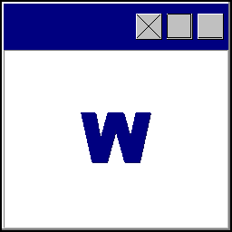
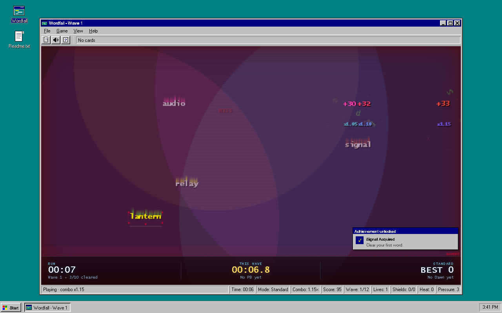
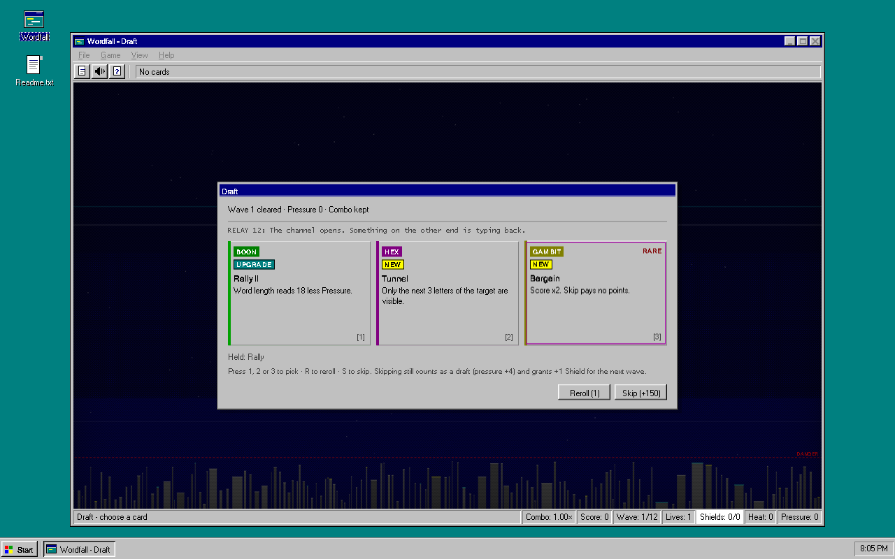
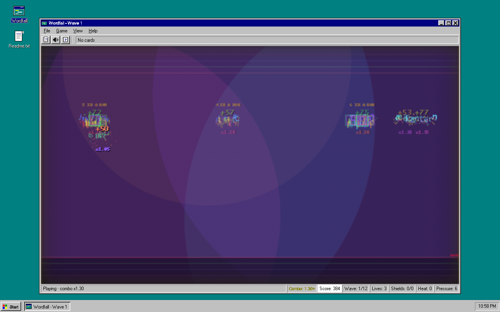
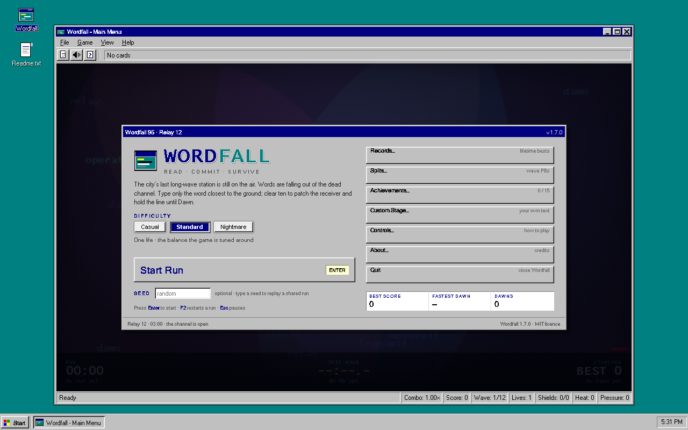
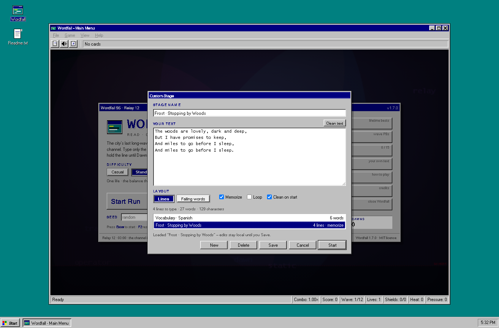
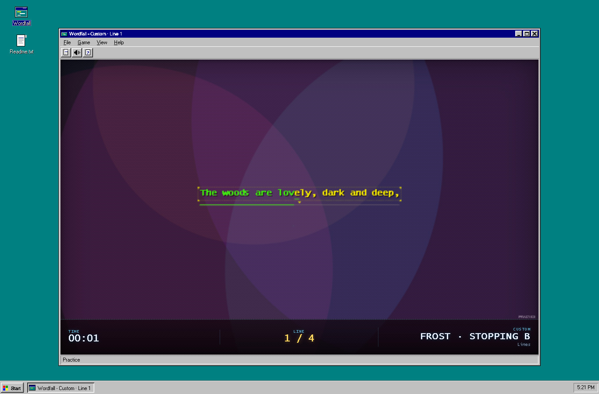
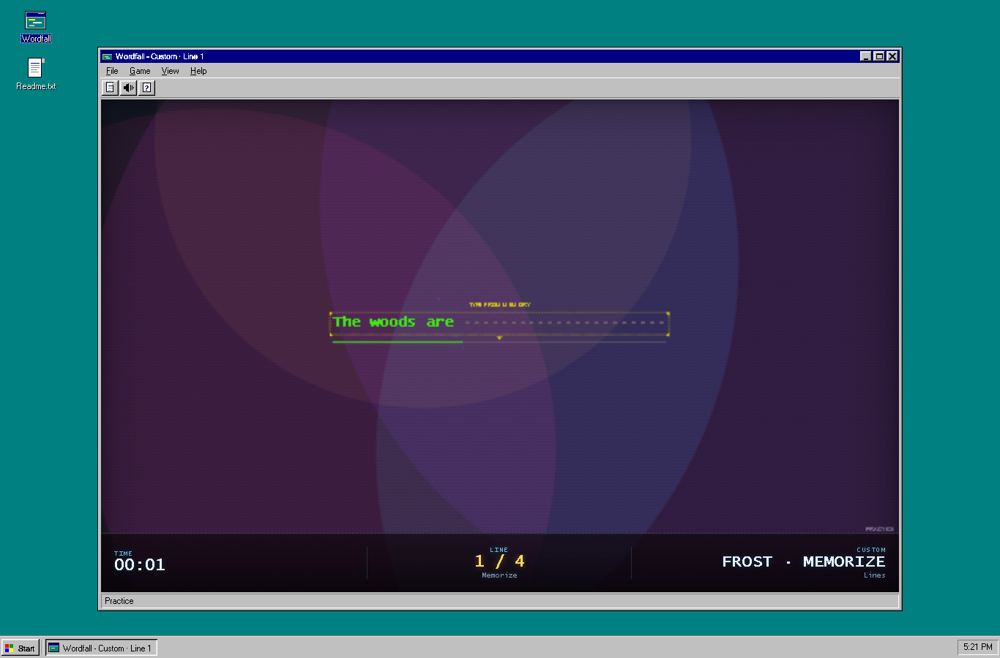

<div align="center">



# Wordfall

**A one-screen typing roguelite dressed as a 1995 Windows application.**<br>
Read. Commit. Survive. Windows and the browser. No account, no ads, no telemetry.

[](https://github.com/Boci0/wordfall/releases/latest)
[](https://github.com/Boci0/wordfall/releases)
[](#download)
[](LICENSE)
[](#build-from-source)

<br>

[](https://github.com/Boci0/wordfall/releases/latest)
&nbsp;
[](https://boci0.github.io/wordfall/)

[Features](#features) &nbsp;·&nbsp; [Download](#download) &nbsp;·&nbsp; [How it plays](#how-it-plays) &nbsp;·&nbsp; [Build from source](#build-from-source) &nbsp;·&nbsp; [Documentation](#documentation) &nbsp;·&nbsp; [Changelog](CHANGELOG.md)

<br>



<br><br>


&nbsp;&nbsp;&nbsp;

&nbsp;&nbsp;&nbsp;


<br><br>


&nbsp;&nbsp;&nbsp;

&nbsp;&nbsp;&nbsp;


</div>

<br>

## Features

<table>
<tr>
<td width="50%" valign="top">

### Type the lowest word

- Words fall down one screen, and only the word closest to the line accepts keys
- Your first correct letter locks onto a word and holds until it clears
- Every clean letter feeds the combo; a wrong key breaks it, or eats a Shield
- Letters shatter the glyph they land on; a clear throws shockwaves, screen bands and call-outs

</td>
<td width="50%" valign="top">

### Draft your way through

- Clear ten words and the board freezes for a draft of one card from three
- 18 cards in three lanes: **Boons** patch you, **Gambits** overclock you, **Hexes** corrupt you
- Duplicate picks upgrade a card to tier II; reroll once per run
- Skip pays `150 × wave` and a Shield for the next wave, but still raises Pressure

</td>
</tr>
<tr>
<td width="50%" valign="top">

### Build Pressure, chase score

- Pressure = clears + 4 × drafts taken; it drives word length, spawn rate and fall speed
- Heat - one per Hex held - multiplies your score and keeps climbing
- Combo, close calls and card multipliers stack
- Spawns follow a demand curve calibrated to real typist percentiles, so the run asks for a
  typing speed (~16 WPM at wave 1, ~92 at wave 12) instead of hitting one wall
- Every run has a seed; type one on the main screen to replay a shared run, or use
  **Retry Seed**

</td>
<td width="50%" valign="top">

### Hold the line until Dawn

- One Life; a word reaching the line takes it
- Shields eat a wrong key and refill at the start of each wave
- Survive twelve waves to reach Dawn, then keep playing score-only
- Lifetime records for best score, wave and combo, runs, Dawns and fastest Dawn

</td>
</tr>
<tr>
<td width="50%" valign="top">

### Chase the clock

- A live run clock in the signal strip, frozen by pauses and drafts
- Every wave is timed; the signal strip shows the live split and its PB
- One readout per fact: the strip owns the clock and mode, the status bar keeps the combo,
  score, wave and survival panels
- **Game → Splits…** lists best split and cumulative time for all twelve waves
- Fifteen achievements, from a flawless wave to a sub-five-minute Dawn

</td>
<td width="50%" valign="top">

### Pick your frequency

- **Casual**, **Standard** and **Nightmare** modes, chosen on the main screen or
  **Game → Difficulty**
- Casual starts with two lives and slows the board; Nightmare speeds it up and keeps one life
- The mode is remembered and named on the result screen
- Records and achievements are shared, so the score stays comparable

</td>
</tr>
<tr>
<td width="50%" valign="top">

### Windows 95, for real

- A full Win95 **main screen**: wordmark, Start Run, difficulty, stats and shortcuts, with
  attract-mode words drifting behind it
- 16-colour palette, bevelled chrome, Tahoma, and working menus, dialogs, toolbar, taskbar and Start menu
- Browser: the full fake desktop around the window. Native: just the borderless app window
- **View → Effects** switches Full and Light; `prefers-reduced-motion` is respected
- Mechanical key clicks, rising chords and a compressor that keeps it clean

</td>
<td width="50%" valign="top">

### Stays on your machine

- No account, no ads, no telemetry, and it works offline
- Records, splits, achievements and settings live in `localStorage` on this machine
- The updater talks only to GitHub's release API, and only when it checks
- The native app checks for updates at launch and from **Help → Check for Updates…**

</td>
</tr>
<tr>
<td width="50%" valign="top">

### Practice with your own text

- **Custom Stage…** on the main screen or in the Game menu takes anything you paste
- Keep up to 20 saved stages; **New** starts another, **Delete** removes the loaded one
- Type it as **Lines**: one display row at a time, spaces and punctuation included
- Or as **Falling words**: every 2-16 letter word drops in, at a fixed gentle pace

</td>
<td width="50%" valign="top">

### Drill it until it sticks

- **Clean text** strips citation markers like `[1]` and `[b]`, links, URLs and wiki clutter
- **Clean on start** runs that cleanup automatically on every start
- **Memorize** previews each line for 3.5 s, then hides the rest behind dots
- **Loop** runs the same text again and again
- In a drill the status bar collapses to one **Practice** panel and the strip shows time,
  line/word progress and the stage name
- No cards, no lives, no Pressure; finishing shows time, keys, WPM and accuracy
- Nothing touches your records or achievements

</td>
</tr>
</table>

## Download

Grab the latest build below, or browse every file on the [releases page](https://github.com/Boci0/wordfall/releases/latest).

| Platform | Get it | Notes |
| :--- | :--- | :--- |
| **Windows 10/11** | [**Wordfall for Windows**](https://github.com/Boci0/wordfall/releases/latest) | The native app: a real borderless window and in-app updates. Download the win64 zip, extract it, run `Wordfall.exe`. |
| **Any browser** | [**Play Wordfall**](https://boci0.github.io/wordfall/) | Nothing to install. The complete fake desktop, menus and dialogs. |

The browser build also runs straight from the repository: open `index.html`, with no server
and no dependencies.

<details>
<summary><b>Windows requirements and first run</b></summary>
<br>

- Windows 10 or 11, x64.
- The **.NET 10 Desktop Runtime** - the app is framework-dependent, so the runtime is not bundled.
- The **WebView2 runtime**, which ships with Windows 11 and most Windows 10 installs.

Unzip the release anywhere and run `Wordfall.exe`; there is no installer. Records, settings
and the WebView2 profile are kept in `%LOCALAPPDATA%\Wordfall`, outside the app folder, so
updating or moving the app keeps them. The app checks GitHub for a newer release shortly
after launch and from **Help → Check for Updates…**; nothing is installed unless you say yes.

</details>

## How it plays

You are the night operator at **Relay 12**, the city's last long-wave station. Words are
falling out of the dead channel, and you have until Dawn to hold the line.
**Read. Commit. Survive.**

- **The main screen is the title card.** Start a run, pick Casual / Standard / Nightmare,
  or open Records, Splits, Achievements, Custom Stage, Controls and About without leaving
  the window.
  **File → Main Menu** and the pause / game-over dialogs always bring it back.
- **Only the lowest word is live.** Everything else is inert until it becomes the target.
  Your first correct letter locks on, so you commit to a word the moment you begin it.
- **Ten clears make a wave.** The board freezes and a draft opens: slot 1 is a Boon, slot 2
  anything, slot 3 a Hex or Gambit. Pick one, reroll once, or skip.
- **Pressure never stops climbing.** It is `cleared + 4 × drafts taken`, and it sets word
  length, spawn rate and fall speed - so skipping does not dodge the difficulty.
- **The curve asks for a typing speed.** Spawn intervals are derived from a demand curve
  calibrated to real typist data: about 16 WPM at wave 1, the median typist around wave 6
  and roughly the top 1-2% at wave 12. The climb is smooth instead of a single wall.
- **Long words get a little more air.** Nine- and ten-letter words fall 8% slower, so the
  longest bands are tense rather than a death sentence; **Casual** slows the whole board.
- **One Life, and Dawn at wave 12.** Shields absorb wrong keys, Lifeline absorbs a hit, and
  after Dawn the run continues in endless, score-only mode.
- **The clock never stops when the board does.** Pauses and drafts freeze the run clock, but
  every wave is timed; the best split for each wave is kept in **Game → Splits…**.
- **Fifteen achievements** track the run, from the first clear to a sub-five-minute
  Nightmare Dawn; they unlock with a notification and live in **Game → Achievements…**.
- **Choose Casual, Standard or Nightmare** on the main screen or from **Game → Difficulty**.
- **Bring a seed.** Every run has a seed; type one on the main screen to replay a shared run,
  or use **Retry Seed** on the result or Dawn dialog.
- **Practice with anything you paste.** **Custom Stage…** on the main screen or in the
  **Game** menu turns text into a drill: **Lines** to type it exactly as written, or
  **Falling words** to clear from the board. **New** keeps up to 20 saved stages,
  **Clean text** strips the citation markers, links and wiki clutter a web paste drags in
  (**Clean on start** does it automatically), **Memorize** hides each line after a short
  preview and **Loop** runs it again; there are no cards, lives or Pressure, and it never
  touches your records.
- **A keyboard is required.** The browser build and the native app play identically.

### Controls

| Key | Action |
| --- | --- |
| letters | type the target word (the lowest word, or the word you locked onto) |
| Enter | start / retry / continue after Dawn; also resumes while paused |
| Esc | pause a run; while paused, resume (or close a dialog or menu) |
| 1 2 3 | draft: pick the matching card |
| R | draft: reroll the offer (once per run) |
| S | draft: skip (`+150 × wave` points, +1 Shield next wave, still raises Pressure) |
| F2 | new run; in a custom stage, restart the same text |
| Game menu | Difficulty, Custom Stage…, Splits…, Achievements… and Records… |
| Custom | **Custom Stage…** on the main screen or **Game** menu; in a drill Esc pauses and F2 restarts the same text |

Everything in the window is clickable: the main screen, File / Game / View / Help menus, the
toolbar, desktop icon, taskbar button and title-bar buttons all work. The main screen and the
Game menu carry Difficulty, Custom Stage…, Splits…, Achievements… and Records…; the
game-over dialog carries Retry, Retry Seed, Main Menu and Quit, and the pause dialog has
Main Menu too.

<details>
<summary><b>The 18-card deck</b></summary>
<br>

Tier I effects; picking a card again upgrades it to tier II where the card allows it.

**Boons** - clean patches

- **Wide Scope** - the target set includes the 2nd lowest word
- **Overclock** - every 5th clear auto-clears the next target
- **Grace** - +1 Life
- **Steady Hand** - +1 Shield
- **Slow Drift** - fall speed ×0.85
- **Lifeline** - the first word to reach the line is destroyed instead of costing a Life
- **Rally** - word length reads 10 less Pressure

**Gambits** - overclock the transmitter

- **Greed** - score ×1.4, fall speed ×1.03
- **Longshot** - 7+ letter words score ×2 and fall 5% faster
- **Ledger** - +2 points per letter
- **Drought** - spawns 15% slower, score ×0.9
- **Bargain** - score ×2, Skip pays no points

**Hexes** - corrupted packets

- **Reverse** - type the target word right to left
- **Tunnel** - only the next 3 letters of the target are visible
- **Ghost** - each cleared word leaves an inert echo in place for 3 seconds
- **Decoy** - 1 in 8 spawns is a misspelled fake; while it is the lowest word, every key is a mistake
- **Split** - every 5th spawn also drops a free word; it scores, but blocks the words above it
- **Second Draft** - +1 reroll for the run

</details>

## Build from source

**Browser build** - nothing to build.

```bash
git clone https://github.com/Boci0/wordfall.git
cd wordfall
start index.html        # Windows; or just open the file in any browser
```

It is plain HTML, CSS and JavaScript: no bundler, no server, no dependencies.

**Native Windows app** - needs the .NET 10 SDK and the WebView2 runtime.

```powershell
powershell -NoProfile -ExecutionPolicy Bypass -File win\build.ps1
powershell -NoProfile -ExecutionPolicy Bypass -File win\build.ps1 -Smoke
```

`build.ps1` publishes `dist\Wordfall-win64\Wordfall.exe`; `-Smoke` also launches the
published exe and runs its self-test. The four web files are embedded into the exe at build
time, so rebuild after changing the game. `install.ps1` copies the build into
`%LOCALAPPDATA%\Programs\Wordfall` and (re)creates the desktop shortcut.

<details>
<summary><b>Checks</b></summary>
<br>

```bash
node tools/smoke.mjs            # Playwright UI, rules, effects and frame-time checks
node tools/qa-v15.mjs           # main screen, clock, splits, achievements, difficulty, decoy, CPU budget
node tools/qa-custom.mjs        # custom stages: entry, layouts, memorize, loop, New/multi-stage, text cleanup, isolation
node tools/bot.mjs --seeds 100  # headless WPM bot against the SPEC balance targets
```

All drive headless Chrome through `playwright-core`. The debug hook, the updater
diagnostics and the balance lab are documented in the
[technical notes](TECHNICAL.md#tests).

</details>

## Documentation

| Document | What is in it |
| :--- | :--- |
| [SPEC.md](SPEC.md) | The design doc: rules, cards, milestones and tuning targets |
| [TECHNICAL.md](TECHNICAL.md) | Renderer, presentation, native shell, updater, test harnesses and tuning |
| [CHANGELOG.md](CHANGELOG.md) | Every release, from v1.0 to v1.7.0 |
| [BALANCE-LAB.md](BALANCE-LAB.md) | Measured card power, draft-offer distribution and tuning recommendations |
| [QA-REPORT.md](QA-REPORT.md) · [QA-REPORT-M6.md](QA-REPORT-M6.md) · [QA-REPORT-M7.md](QA-REPORT-M7.md) · [QA-JUICE.md](QA-JUICE.md) | Independent acceptance reviews for each milestone |
| [QA-REPORT-V15.md](QA-REPORT-V15.md) · [QA-DECOY.md](QA-DECOY.md) | v1.5 verification, and the decoy / "long words don't die" investigation |
| [win/README.md](win/README.md) | The native Windows shell in detail |

## Feedback

Found a bug or want something added? [Open an issue](https://github.com/Boci0/wordfall/issues).
Include the version from **Help → About**, and the seed if the bug is specific to a run.

<br>

<div align="center">
<sub>Wordfall 1.7.0 &nbsp;·&nbsp; MIT licence &nbsp;·&nbsp; Built with JavaScript, WinForms and WebView2 &nbsp;·&nbsp; © 2026 Boci0</sub>
</div>
