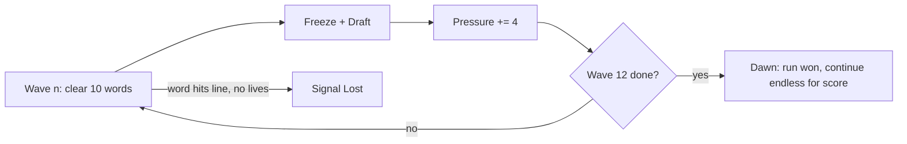

# Wordfall: Design Spec (v2.1)

A one-screen typing game with a draft-only roguelite layer. No map, no branches.

Status: **M1-M7 implemented**, current build v1.6.0, presented as a Windows 95-era desktop
application (browser and native Windows build), plus the Relay 12 background and curve
smoothing in §11, the M7 impact/draft-balance pass in §12, the native in-app updater in
§13, the v1.5 score-attack pass in §14, and the v1.6 typing-speed curve and seed picker in
§15. M5 numbers, tuning notes and deviations are in §9; the M6 additions and their measured
numbers are in §10; M7 is in §12, with the measured card-power evidence in
[BALANCE-LAB.md](BALANCE-LAB.md).

## 1. Pillar

> **Read. Commit. Survive.** You may only type the word closest to the ground.

Every card bends exactly one of three things:
- **The rule:** which words you're allowed to type (Wide Scope, Overclock)
- **The reading:** how words look (Reverse, Tunnel, Ghost, Decoy)
- **The economy:** score, speed, survival (Greed, Ledger, Grace, Slow Drift)

If a proposed card doesn't bend one of these, cut it.

## 1.1 Setting - Relay 12 (current build)

Relay 12, 03:00. The city's last long-wave station is still on the air. After midnight the
dead channel starts dropping words - fragments of a broadcast that was never sent. The
player is the night operator: type each fragment before it reaches the line, patch the
receiver when a wave ends, and hold the line until Dawn. "Signal Lost" is the relay going
dark.

The fiction is carried by:
- the **Welcome** and **About** dialogs (setting + what Boons, Gambits and Hexes are in
  diegetic terms);
- a one-line **relay log** in every draft (`RELAY 12 - …`), one beat per cleared wave;
- an **abstract signal horizon** in the playfield: irregular vertical bars and spectrum
  clusters, no buildings, windows or mast. This is the only visual change; there is no
  new screen and no new asset.

Copy lives in `index.html` (Welcome/About) and `RELAY_LOG` in `game.js` (draft lines).
The log is flavor only: no rule reads it.

## 2. Run structure



- **Wave** = 10 clears. The draft opens when a wave ends. The board freezes, and words keep their positions.
- **Pressure** is the one difficulty variable: `pressure = cleared + 4 x draftsTaken`.
  - `wordRange`, `spawnInterval` and `speed` all read `pressure` instead of `cleared`. (Small code change: swap one input.)
  - Skip still counts as a draft taken. You can't dodge escalation by skipping.
- **Dawn:** finishing wave 12 wins the run. Play continues in endless mode with a score-only goal. Without this, the game has no ending.
- **Target run length:** 8 to 12 minutes for a 60 WPM player.

### 2.1 Pause, records, seeds and run stats (M6)

- **Pause is a phase** (`paused`). `Esc` while playing pauses; `Esc` or `Enter` resumes, and
  Game → Pause/Resume is the mouse path. Printable letters always type - a typing game
  cannot spend a letter on a hotkey. The board and the *playing-time* clock freeze while
  paused; the pause dialog shows `Seed N · MM:SS played`. Minimize auto-pauses, and restore
  resumes only that minimize-induced pause, never a pause the player asked for.
- **Run stats:** each run tracks correct letters, wrong keys (shield-eaten wrong keys
  included), seconds spent in the `playing` phase, and its seed. The game-over and Dawn
  dialogs show
  `wave · words cleared · best combo · WPM · accuracy% · MM:SS · Seed N`.
  WPM = correct letters / 5 per minute of playing time; accuracy = correct /
  (correct + wrong keys). **Retry Seed** on the game-over dialog starts a new run on the
  same seed.
- **Records** are lifetime and per machine: `{runs, dawns, bestScore, bestWave,
  bestCombo, words, fastestDawnSec}` in `localStorage` key `wordfall.records`, written
  exactly once when a run ends (game over or Dawn), and migrated from the old
  `wordfall.best` key. Game → Records… shows them; the welcome dialog keeps showing the
  record best score. Headless tuning sweeps do not touch the record book.
- **Settings:** `wordfall.settings` (`{muted}`) persists the sound toggle.
- **Seeded runs:** `reset(seed?)` seeds the PRNG deterministically, so a seed reproduces
  the same run. The headless bot drives runs through the same path. Since v1.6 the main
  screen also accepts an optional seed (digits only) for **Start Run** / Enter, so a seed
  can be typed in as well as replayed with **Retry Seed** (§15.5).

## 3. Scoring

```
points = letters x (10 + ledger) x comboMult x heatMult x Greed x Longshot x Drought x Bargain
comboMult = 1 + 0.05 x min(combo, 20)      // unchanged, max 2.0x
heatMult  = 1 + 0.25 x heat                // heat = number of Hexes held (+ tier II counts twice)
```

- Combo carries through the draft pause (resolves Q2).
- Combo resets on a wrong key or a word hitting the line. Word progress is kept after a wrong key (M1 rule, revisit in M5).
- M7 economies: Greed ×1.4 (tier II ×1.7), Longshot ×2 on 7+ letter words, Drought ×0.9
  (tier II ×0.85) in exchange for slower spawns, Bargain ×2 with Skip paying nothing.
  Close-call clears and combo milestones are presentation only - they never change score.

## 4. Mechanical primitives

Cards may only use these. If a card needs something new, add it here first.

| Primitive | Definition |
| --- | --- |
| **Life** | Word hits the line: lose 1. At 0 the run ends. Start: 1. |
| **Shield** | Takes the hit from one wrong key: combo kept, no flash. Refills when a wave starts. |
| **Heat** | Count of Hexes held. Feeds `heatMult`. Never goes down. |
| **Target set** | The words you're allowed to type. Default: the lowest one. |
| **Lock-on** | When the target set holds more than 1 word, the first correct letter locks onto one word (ties go to the lowest). The lock holds until that word is cleared. |
| **Line save** | A once-per-run effect (Lifeline) that destroys the first word to reach the line instead of costing a Life. It does not clear a wave and keeps the combo. |
| **Pressure** | See §2. |

## 5. Cards

### 5.1 Draft rules

- 3 cards. Slot 1 = **Boon**, slot 2 = any type, slot 3 = **Hex or Gambit**. No duplicates within one draft.
- **Reroll:** 1 per run (Second Draft adds one). **Skip:** `150 x wave` points and +1 temporary
  Shield for the following wave; it still counts as a draft (Pressure +4) and Bargain makes it pay 0.
- Rarity is rolled per slot: **24% base + 1.2% per wave**, except slot 3 which starts at 30%,
  capped at 45% for every slot. A rare roll with no eligible rare in the slot's lane falls
  back to any eligible rare card (cross-lane fallback), so a rare roll always delivers a rare
  while one exists. Slot 2 prefers a card type different from slot 1 70% of the time, so late
  drafts do not become two Hex picks while the ANY slot still carries Boons (always
  excluding them removed the Boon lane and starved runs; never excluding them made 60 WPM
  random too hot).
- Repeat pick: upgrades to tier II if the card has one. Otherwise the card leaves the pool after the first pick. Draft cards carry a NEW or UPGRADE tag.
- Slot exhaustion: if every card of a slot's type is ineligible, that slot falls back to any other eligible card so the draft still shows three cards. If the whole pool is exhausted the slot is empty (only Skip is available).
- Auto-clears (**Overclock**) score and count toward Pressure, but do not count toward a wave: a wave is exactly ten player clears.
- Between waves the board holds for a 0.85 s "WAVE n CLEARED" beat (presentation only; headless `sim()` skips it so tuning runs keep exact timing).

### 5.2 Card list (18)

| Card | Type | Rarity | Effect | Tier II |
| --- | --- | --- | --- | --- |
| **Wide Scope** | Boon | rare | The target set includes the 2nd lowest word (uses lock-on) | 3rd lowest too |
| **Overclock** | Boon | rare | Every 5th clear auto-clears the next target. Auto-clears give points but no combo | Every 4th |
| **Grace** | Boon | common | +1 Life | none |
| **Steady Hand** | Boon | common | +1 Shield | +2 Shields |
| **Slow Drift** | Boon | common | Fall speed x0.85 | x0.75 |
| **Lifeline** | Boon | rare | The first word to reach the line is destroyed instead of costing a Life (once per run; combo kept) | none |
| **Rally** | Boon | common | Word length reads 10 less Pressure | 18 less |
| **Greed** | Gambit | common | Score x1.4, fall speed x1.03 | x1.7 / x1.06 |
| **Longshot** | Gambit | rare | 7+ letter words score x2 and fall 5% faster | none |
| **Ledger** | Gambit | common | +2 points per letter | none |
| **Drought** | Gambit | common | Spawn interval x1.15, score x0.9 | x1.20 / x0.85 |
| **Bargain** | Gambit | rare | Score x2; Skip pays no points | none |
| **Reverse** | Hex | common | Type the target word right to left | none |
| **Tunnel** | Hex | common | Only the next 3 letters of the target (in typing order) are visible | Next 2 |
| **Ghost** | Hex | common | Each cleared word leaves an inert echo in place for 3 s | none |
| **Decoy** | Hex | rare | 1 in 8 spawns is a misspelled fake that drops 4.5× faster. While a fake is the lowest word, every key counts as a mistake. Fakes fall through the line harmlessly | 1 in 5 |
| **Split** | Hex | common | Every 5th spawn also drops a free word. It is a real 3-5 letter word: it scores and counts toward the wave, blocks the words above it while it falls, and costs no life at the line. It spawns even when the queue is full (the Hex's cost) | Every 3rd spawn |
| **Second Draft** | Hex | rare | +1 reroll for the run | none |

**M6 promoted Split** as the fifth Hex and 13th card. The free word carries
`word.harmless === true`, renders teal (`COL.splitWord = '#00a0a0'`) with a dotted marker
above it (fakes are marked below), and is never a fake. Its cadence lives in
`splitEvery()` (5th spawn at tier I, 3rd at tier II), not in `CFG`.

**M7 draft-balance pass** added five cards and retuned three traps, all measured in
[BALANCE-LAB.md](BALANCE-LAB.md): before the pass the marginal pick spread ran from
Overclock I (+42 pp dawn) to Longshot (−18.5 pp), Greed II was a downgrade over Greed I, and
a slot-3-only deck dawned 0% while slot 1 only dawned 100%. After the pass the spread is
about +61 pp to −8 pp, slot-3-only decks reach ~21%, and the acceptance cells still hold.
The changes: Greed's speed penalty ×1.10/×1.20 → ×1.03/×1.06 (score up to ×1.4/×1.7),
Longshot's speed penalty 20% → 5%, Ledger's hidden +8 Pressure surcharge removed, Skip
50 → 150 × wave plus a shield, wave-scaled rarity + cross-lane rare fallback + slot-2 lane
diversity, and the five cards above (Lifeline and Rally add boon tiers; Drought is the
first survival-positive Hex/Gambit lane card; Bargain and Second Draft widen slot 3's thin
rare pool).

### 5.3 Card interactions (defined up front)

- **Reverse + Tunnel:** Tunnel counts in typing order, so it shows the rightmost unrevealed letters. The two stack.
- **Reverse + Wide Scope:** lock-on uses the word's *first letter in typing order*.
- **Decoy + Wide Scope:** a fake in the target set doesn't block if a real word in the set can be locked.
- **Overclock + Decoy:** auto-clear skips fakes.
- **Greed + Slow Drift + Drought:** speed and spawn multipliers stack; Drought does not touch fall speed.
- **Lifeline + Split:** a harmless Split word never reaches the "costs a Life" branch, so it cannot consume Lifeline.
- **Rally + Ledger:** Rally subtracts from the word-length bucket only; Ledger no longer adds Pressure.
- **Second Draft + Bargain + Skip:** Bargain zeroes the Skip payout but the +1 Shield still applies.

### 5.4 Eligibility filter (no dead picks)

| Card | Offered only when |
| --- | --- |
| Longshot | the current word range includes 7+ letter words |
| Wide Scope II | Wide Scope I is held |
| Grace | lives held < 3 |
| Steady Hand | shields held < 3 |
| Any Hex | the player doesn't already hold all 6 |
| Any maxed card | the player has not already reached its `maxTier` |

The Hex rule is generic: it reads the number of Hex cards in `CARD_LIST` (exported as
`window.__wordfall.hexTotal`), so it stays correct as the pool grows - M6 added Split and
M7 added Second Draft, and the check moved from 4 to 6 without a hard-coded list. The
sweeps in [BALANCE-LAB.md](BALANCE-LAB.md) show 0 dead drafts, 0 ineligible offers and no
duplicate cards within a draft.

## 6. Decisions log

| Decision | Status |
| --- | --- |
| Canvas, single page, no build step, monospace | **Superseded** - gameplay is still a canvas playfield, but the shell is a Windows 95-style DOM/CSS application (title bar, menus, status bar, dialogs). The web version still has no build step; the native Windows build (§9) adds a .NET shell. |
| No map, draft-only roguelite | Kept |
| No backspace | Kept |
| Wrong key keeps word progress | Kept. First thing to revisit in M5 |
| Draft trigger = waves of 10 clears | **New** (resolves Q1) |
| Combo carries through the draft | **New** (resolves Q2) |
| Split goes to the backlog | **Resolved in M6** - promoted as the 13th card, Hex / common (§5.2) |
| Keyboard only, no touch | Kept (Q4 closed) |
| Dawn win state at wave 12 | **New** |
| Win95-era presentation, browser + native | **New** (§9) |
| Pause is a real phase; Esc pauses, Esc/Enter resumes | **New (M6)** - no letter is spent on a hotkey; the run clock freezes (§2.1) |
| Lifetime records in localStorage, per machine | **New (M6)** - `wordfall.records`; no accounts, and records never leave the machine. The native build's update check is the only network request and only contacts the public GitHub release API (§13) |
| Runs carry a visible seed and can be retried | **New (M6)** - seed on pause/game-over/Dawn; Retry Seed replays it (§2.1) |
| Sound setting persists across launches | **New (M6)** - `wordfall.settings` (§2.1) |
| Impact layer: capped FX pools + adaptive budget | **New (M7)** - presentation never mutates rules and is skipped in `sim()`; 60fps verified under load (§12) |
| Effects quality toggle, persisted | **New (M7)** - View → Effects: Full/Light; `wordfall.settings.fx` (§12) |
| 18-card pool with wave-scaled draft rarity | **New (M7)** - measured in BALANCE-LAB.md; acceptance cells unchanged (§5, §12) |
| Native build updates itself from GitHub releases | **New (v1.3)** - user-confirmed download, SHA-256 verified, detached swap + relaunch; browser build just links the release page (§13) |
| Skip is a real choice (score + shield), still +4 Pressure | **New (M7)** - `150 × wave` points and +1 temporary Shield (§5.1) |

## 7. Milestones (with acceptance criteria)

| Milestone | Scope | Done when | Status |
| --- | --- | --- | --- |
| **M2 Draft + Pressure** | `draft` phase, wave counter, `pressure` replaces `cleared` in the ramps, 3 starter cards: **Slow Drift** (Boon), **Greed** (Gambit), **Reverse** (Hex), plus Heat in scoring/HUD, Skip, Reroll, keys 1/2/3/R/S | Smoke test: clearing 10 words enters `draft`, picking resumes play with combo kept, pressure +4, and Heat changes the score | **Done** |
| **M3 Card set** | Remaining 9 cards, primitives (Shield, Lock-on), eligibility filter, tier II | Smoke test per card through `__wordfall` (force a pick, assert the effect). No card offered while ineligible across 1000 seeded drafts | **Done** |
| **M4 Feel** | Hit-pause on clear, particles, combo pitch rise, near-miss shake, danger-line audio, card rise animation | Manual playtest checklist. 60 fps held with 12 words + Ghost echoes | **Done** |
| **M5 Tuning** | Headless bot at 40/60/80 WPM with random picks, plus a word pool of 400+ words | 60 WPM bot, no cards: dies at wave 5 to 7. 60 WPM with picks: reaches Dawn in 30 to 50% of runs. 80 WPM: over 70% | **Done** |
| **M6 Pause + records + run identity + Split** | `paused` phase and dialog, lifetime Records, WPM/accuracy/run-time/seed stats on game-over and Dawn, Retry Seed, settings persistence, 13th card Split | Smoke test: pause freezes board and clock and resumes via Esc/Enter; records load and save once per finished run; `reset(seed)` is deterministic; the result dialogs carry WPM/accuracy/time/seed; Retry Seed replays the seed; Split spawns a real harmless 3-5 letter word on its cadence and is the fifth Hex. Bot: all M5 cells still pass at 400 seeds | **Done** |
| **M7 Impact + draft balance + 18 cards** | Capped canvas effect layer (particles, glyph shards, rings, pop-ups, milestones, wave-clear beat, ambient motion, adaptive budget), per-word typing/clear impact, Effects Full/Light toggle, status combo panel + CSS FX overlay; 5 new cards, trap retune, wave-scaled rarity, cross-lane rare fallback, slot-2 lane diversity, Skip rework | Smoke test: effect pools fire on a clear, milestone and wave-clear beat, FX toggle + persistence + CSS hooks, full-board 60fps check; every card asserted; bot: 60 skip dies 100% median 7, 60 random Dawn 30-50%, 80 random > 70%; balance-lab spread and no dead drafts | **Done** |
| **v1.3 In-app updater** | Native-only update flow: GitHub release check at launch and via Help → Check for Updates…, user-confirmed download of the win64 zip, SHA-256 digest verification, staging under `%LOCALAPPDATA%\Wordfall\updates`, detached PowerShell helper that waits for exit, swaps files and relaunches; read-only install falls back to the release page; CLI diagnostics (`--check-update`, `--update-selftest`, `--write-updater-script`) | Check returns the live latest release and compares versions; download verifies GitHub's published SHA-256 and stages 9 files including `Wordfall.exe`; the install helper replaces a scratch target, cleans staging and relaunches (tested with `-NoStart`); native `--smoke` still passes; no update installs without user consent; offline/failed check is silent | **Done** |

## 8. Backlog / open questions

1. **Split:** **Resolved in M6** - promoted as the 13th card, Hex / common, tier I every
   5th spawn, tier II every 3rd (§5.2). The measured impact is in §10.
2. **Meta progression** (unlocking cards between runs): out of scope.
3. **Word pool:** **Resolved in M5** - 459 words in `words.js`, 38 of them 10-11 letters.
4. **80 WPM bot cell is not discriminative** (99.8% vs a >70% bar). Candidates for a later
   pass: tighten to >85% or add a 70 WPM random cell (30-60%), and/or make the bot's
   draft-quality invariant (slot-1-only vs slot-3-only decks) a first-class acceptance cell.
5. **Bot is blind to reading cost and mistakes**: Reverse/Tunnel/Ghost measure ~0 delta and
   Steady Hand's shields measure 0 because the bot never mistypes. Human playtest is still
   the only signal for those cards ([BALANCE-LAB.md](BALANCE-LAB.md) §8).
6. **Overclock is still the strongest card** (+61 pp marginal in M7). It is the first lever
   if the 60 WPM random cell ever runs hot (nerf cadence 5th→6th / 4th→5th).

## 9. Implementation notes (M5)

What shipped vs. this doc, and the numbers that back the M5 "Done when" column.

**Measured (400 bot runs per cell, seed block 1000-1399, `node tools/bot.mjs --seeds 400`)**

| Cell | Result | Target |
| --- | --- | --- |
| 60 WPM, no cards (`skip`) | dies 400/400 (100%); median wave 6, mean 6.24; `{5:4, 6:299, 7:93, 8:4}` | dies at wave 5-7 |
| 60 WPM, random picks | Dawn 34.8% (139/400) | Dawn 30-50% |
| 80 WPM, random picks | Dawn 100% (400/400) | Dawn > 70% |

The default 100-seed run used by the bot's assertions gives median 6, 33% and 100% on the
M5 build; the M6 re-measure is in §10.

Run-to-run seed blocks vary by a few points; the shipped curve sits mid-band on purpose.

**Deviations from the letter of the doc**

- **Decoy fakes drop faster.** The card table never pinned how fast a fake falls, and
  at normal fall speed a single fake blocked the target for a whole fall (10-20 s), which
  made a picked Decoy an automatic loss and kept random-pick runs far below the M5 Dawn
  targets. Fakes now fall at `CFG.fakeSpeedMult = 4.5×`; the misspelled-fake rule is
  unchanged.
- **Run length.** Target §2 says 8-12 minutes for a 60 WPM player. The bot's winning runs
  average ~4.2 minutes (4.0-4.7 min): reaching wave 12 requires the spawn rate and fall
  speed to stay threatening, and those same two values make clears fast. Human runs are
  longer because of draft reading and imperfect play, but the gap is real.
- **Tuning lives entirely in `CFG`** (see README §Tuning), including `wordRangeSteps`
  and `fakeSpeedMult`. Any change to the curve should be checked with `tools/bot.mjs`.
- **Deterministic sim seeding.** `setSeed()` hashes the seed before feeding the PRNG
  (splitmix32-style), otherwise adjacent seeds were correlated enough to bias bot sweeps
  by ±20 points on Dawn rate. Normal play seeds from the clock, so this only affects the
  headless bot.
- **Pressure scale.** The old M1 ramp (`speedPerClear 1.9`, `spawnMin 0.8`, range
  up to `[5,11]`) was far too steep once Pressure added 4 per draft; M5 retuned it to
  `speedPerClear 0.354`, `maxSpeed 45`, `spawnMin 1.05`, and a `[6,10]` late word range.
- **Faster fall after playtest.** The first M5 build felt sluggish ("words fall too
  slow"): crossing took ~38 s at wave 1 and ~18.6 s at max pressure. The shipped curve
  doubles it to `baseSpeed 52` / `maxSpeed 95` / `speedPerClear 0.662`, i.e. ~16 s and
  ~8.8 s, with `maxWords` halved to 6 and `spawnMin` raised to 1.25 s so the smaller,
  faster queue preserves the same survival margins. M5 numbers above are from that build.

**Presentation (Windows 95-era)**

- The shell is a Win95 application: teal desktop with icons and taskbar in the browser
  build, borderless native window with the same chrome in the native build. Real DOM/CSS
  elements (title bar, menu bar, toolbar, status bar, Start menu, modal dialogs), not
  canvas imitations: Win95 grey, 2px bevels, Tahoma / Microsoft Sans Serif.
- The playfield is a 16-colour canvas: ordered-dither sky, abstract signal-field horizon,
  Lucida Console words, square particles, dotted target brackets.
- The rules run in a **fixed 800-unit-tall logical playfield**, uniformly scaled to the
  client area. This keeps fall times - and therefore difficulty - identical at any window
  size; the bot's M5 numbers are the same in a 1024×768 window and a maximised 1080p one.
- Native build: `win/` is a .NET 10 WinForms + WebView2 shell. It embeds `index.html`,
  `style.css`, `words.js`, `game.js` as resources and serves them from
  `https://wordfall.local/` in memory (so `localStorage` works), then removes the real
  title bar: the page's title bar drags the window and its buttons post
  `drag`/`min`/`max`/`close` to the host. Build with `win/build.ps1 -Smoke`; output is
  `dist/Wordfall-win64/Wordfall.exe`.

## 10. Implementation notes (M6 / v1.1)

What shipped against §2.1, §5.2 and the M6 milestone, and the numbers behind it. The
independent M6 acceptance review is [QA-REPORT-M6.md](QA-REPORT-M6.md); the v1.0 review
`QA-REPORT.md` is kept as a historical record and was not rewritten.

**Measured on the shipped M6 build** (my own fresh runs; the same commands and seed blocks
as §9, not numbers carried over from M5):

| Cell | 400 seeds (block 1000-1399) | 100 seeds | Target | Result |
| --- | --- | --- | --- | --- |
| 60 WPM, no cards (`skip`) | dies 400/400; median 6, mean 6.24, `{5:4, 6:299, 7:93, 8:4}` | dies 100/100; median 6, `{6:78, 7:21, 8:1}` | dies at wave 5-7 | **PASS** |
| 60 WPM, random picks | Dawn **37.3%** (149/400) | Dawn **40.0%** (40/100) | Dawn 30-50% | **PASS** |
| 80 WPM, random picks | Dawn **98.8%** (395/400) | Dawn **99.0%** (99/100) | Dawn > 70% | **PASS** |

`node tools/smoke.mjs` on the same build: **133/133 checks pass, 0 page/console errors,
≈22 s**. It covers pause (board and playing clock frozen, Escape/Enter resume), records
(localStorage round-trip and save-once-per-run), deterministic `reset(seed)` and Retry
Seed, the WPM/accuracy/time/seed result line, and Split (real short harmless word on the
5th/3rd-spawn cadence, typeable and scoring, no life at the line, bypasses `maxWords`,
never fake). The eligibility sweep re-checks 1050 seeded drafts with 0 violations.

**Pause.** A real `paused` phase. Escape is the only pause key; Escape or Enter resumes;
printable letters are swallowed while paused (P is a letter, not a resume key). The pause
dialog shows `Seed N · MM:SS played`, offers Resume (default), Restart Run and Controls…,
and opening Controls/About from it returns to the pause dialog. Game → Pause/Resume keeps
the Esc shortcut span and switches its label. `state.runSec` only advances in the
`playing` phase. Minimize auto-pauses; restore resumes only that minimize-induced pause,
not a user pause. Modal-open title-bar buttons are visually inert.

**Records.** `wordfall.records` holds `{runs, dawns, bestScore, bestWave, bestCombo, words,
fastestDawnSec}`, defaults 0, migrated from `wordfall.best`. `recordRun(won)` is called
exactly once per finished run (game over or Dawn), guarded by `runRecorded`, and is skipped
while `state.simulating` so bot sweeps never write the player's record book.
`wordfall.best` is still mirrored for compatibility; the welcome/About best score reads
`records.bestScore`. The dialog lives in the Game menu only.

**Split.** The free word is drawn from the real pool at 3-5 letters via
`pickSpawnText(3, 5)`; it is not a fake. It is typeable, scores like a normal clear and
counts toward the wave; it carries `word.harmless = true` so reaching the line costs no
life, and it is staged above the queue so while it falls it blocks the words above it  - 
that lost reading time is the Hex's cost. It deliberately ignores `maxWords`, so the card
bites even at a full queue. Teal (`COL.splitWord = '#00a0a0'`) with a dotted marker above
the word (fake markers stay below). Tier I every 5th spawn, tier II every 3rd, driven by
`state.spawnCount`; never faked. Hex eligibility is generic over `CARD_LIST`
(`HEX_TOTAL`, exposed as `__wordfall.hexTotal`), so the rule moved from four Hexes to five
without a hard-coded list.

**Settings.** `wordfall.settings` stores `{muted}`, loaded at boot and written on every
sound toggle; the menu label and toolbar button reflect it.

**Deviation / notes.** No `CFG` tuning changed for M6 - the cards changed the random-pick
mix, which moved the 60/random rate from 34.8% (M5) to 37.3% and 80/random from 100% to
98.8%; both remain inside their M5 bands. Run length is unchanged (an 80 WPM bot run
reaches Dawn in ~224 s, 3.7 min mean over 400 seeds). The native shell was rebuilt after
the web freeze: the published `dist\Wordfall-win64\` passes its own `--smoke` as
`version:"M6"` / `embeddedMode:true` and embeds the frozen web files (`Wordfall.dll`
contains the M6 strings). `dist/` is gitignored and regenerated, so a GitHub release must
attach the built folder rather than rely on the repo.

## 11. Relay 12 and curve smoothing (the v1.2 curve; superseded by §15)

**Problem.** Pressure was already linear, but the mapping from Pressure to difficulty was
not. The old `wordRangeSteps` put the first 4+ band at pressure 36, the 5+ band at 48 and
the 6-10 band at 65; `spawnInterval` hit its floor at pressure 31 and `maxSpeed` capped at
65. Wave 4 was therefore the first wave with both the spawn floor and the 4-7 band, and
waves 4-6 stacked three separate steps. That is the wave-4 cliff.

**Background.** The game is now framed as the night shift at Relay 12: words fall out of a
dead long-wave channel, the player patches the receiver at each wave break, and Dawn is the
end of the shift. The Welcome/About copy and the one-line draft log (`RELAY_LOG` in
`game.js`) carry it. The playfield backdrop is an abstract signal horizon - irregular bars
and clusters of one-pixel caps, with no buildings, windows or mast - so the scenery reads as
frozen signal noise rather than a literal city. No rule reads the log; no new screen or
asset was added.

**New curve (all in `CFG`).**

| Key | Value |
| --- | ---: |
| `baseSpeed` | 54 |
| `speedPerClear` | 0.60 |
| `maxSpeed` | 100 |
| `spawnStart` | 2.85 |
| `spawnMin` | 1.16 |
| `spawnDecay` | 0.031 |
| `wordRangeSteps` | `[10,[3,5]] [22,[3,6]] [38,[4,6]] [54,[4,7]] [68,[5,8]] [86,[6,9]] [105,[6,10]]` |

Each length step moves at most one bound. Wave 4 is `4-6` with a 1.55 s spawn interval
instead of `4-7` with the 1.25 s floor. Fall speed keeps rising to pressure 77 instead of
capping near wave 5-6. The 800-unit playfield crosses in ~15.5 s at wave 1 and ~8.4 s once
the speed cap is reached.

**Measured on the implemented build** (`node tools/bot.mjs --seeds 400`, seed block
1000-1399; independent block 5000 in parentheses):

| Cell | Result | M5 target | Status |
| --- | --- | --- | --- |
| 60 WPM, no cards (`skip`) | dies 400/400; median 7, mean 7.13, `{6:1, 7:345, 8:53, 9:1}` | median 5-7 | PASS |
| 60 WPM, random picks | Dawn 33.0% (132/400); 36.0% (144/400) | 30-50% | PASS |
| 80 WPM, random picks | Dawn 96.8% (387/400); 96.3% (385/400) | >70% | PASS |

The default 100-seed run gives median 7, 32.0% and 96.0%. The 80 WPM winning run averages
~231 s. `node tools/smoke.mjs` passes 134/134, including a new check that the draft log is
populated. The debug hook stays `version: 'M6'` so the existing bot/smoke harnesses keep
working; this is a tuning/presentation update, not a new numbered milestone.


## 12. Implementation notes (M7 / v1.2)

M7 is the impact + draft-balance release. Nothing about the rules the bot measures changed
outside the cards and the draft rules themselves; the effect layer is strictly presentation
and is a no-op inside the headless simulator.

### 12.1 Impact and effect layer

The playfield renderer grew a presentation-only effect system driven by four capped pools:
`state.particles` (square sparks, ≤520), `state.shards` (one glyph per cleared letter, ≤140),
`state.rings` (square shockwaves, ≤18) and `state.popups` (floating score/combo/callout
text, ≤22). `burst()`, `shatter()`, `ring()`, `popup()` and `milestone()` are the only
emitters, and each starts with `if (state.simulating) return;`. Because `render()` is never
called inside `sim()`, and every emitter is guarded, the seeded bot stream is untouched by
the effect layer.

**Typing impact.** Each committed letter records `word.typedAt[pos]`; the renderer pops the
glyph (scale 1.55→1.0 over 160 ms, white flash on the first frames) and emits one spark.
Falling words leave two ghost trails whose alpha scales with current fall speed, materialise
out of the signal during their first 240 ms, and the target paints an animated progress bar
plus corner brackets and a dashed box whose dash offset animates.

**Clear impact.** A completed word shatters every letter as a spinning glyph shard, adds a
gold square ring, a score pop-up and a combo-multiplier pop-up, and scales the freeze-frame
(`hitPause`), shake, zoom punch and gold flash by how close the word was to the line. A clear
inside the bottom ~38% of the field additionally shows a CLOSE CALL callout. There is a
combo-milestone burst every 10 (banner, ring, flash, jingle). A lost life shatters the word
red and pops "-1 LIFE". `state.waveBanner` (previously dead state) is now rendered as the
"WAVE n" title card at wave start, and a wave end plays a 0.85 s "WAVE n CLEARED" beat
(`state.waveClearT`, board frozen, `typeLetter()` inert) before the draft opens.

**Ambient motion.** The signal-field bars breathe and their one-pixel caps flicker, a slow
scan line sweeps the field, rare interference bands cross it, stars twinkle and a signal
flare crosses the sky every ~11 s. All time-derived (`state.t`), never rng-derived, so the
renderer cannot perturb the seeded stream.

**Frame budget and adaptive quality.** `CFG.fxMaxParticles/fxMaxShards/fxMaxRings/fxMaxPopups`
cap every pool. `frame()` measures real frame time only while the board is live; if the
90-frame average exceeds 21.5 ms the internal `fxPressure` emitter multiplier drops by 0.2
(floor 0.45), and it recovers when the average is below 17.8 ms. The player-facing
**View → Effects: Full/Light** setting multiplies counts by 0.35, disables ambient motion and
persists in `wordfall.settings.fx`; `prefers-reduced-motion` selects Light on first launch.
Measured in headless Chrome with a full board and continuous clears: 60 fps / ~16.7 ms
average, no frame over 25 ms; light mode is never slower.

**CSS shell.** An `#fxOverlay` layer above the canvas and below the dialogs
(pointer-events:none) carries scanlines, vignette and a combo/danger glow. `game.js` sets
`--fx-combo`, `--fx-danger`, `--fx-heat`, `--fx-lives`, `--fx-wave` on `#app` and toggles
`phase-*`, `fx-combo-hot`, `fx-danger`, `fx-low-life`, `fx-light` and the transient
`fx-milestone` class on `<body>`; `style.css` owns every visual. All loop animations are
transform/opacity only.

### 12.2 Draft balance pass

Evidence: [BALANCE-LAB.md](BALANCE-LAB.md) (13-card baseline, 400 seeds/cell, per-card power
paired by seed, 2,200 seeded drafts, draft-policy proxies). Main findings: slot 3 was a
survival black hole (slot-3-only decks dawn 0%, slot-1-only 100%), the card spread ran
+42 pp (Overclock I) to −18.5 pp (Longshot), Greed II was worse than Greed I, Ledger carried
a hidden +8 Pressure tax, Skip was dominated, and late drafts decayed because the 9 boon
tiers were exhausted by wave ~9.

Shipped changes:

- **Five new cards** (§5.2): Lifeline, Rally, Drought, Bargain, Second Draft (13→18 cards,
  Hexes 5→6).
- **Trap retune**: Greed speed ×1.10/×1.20 → ×1.03/×1.06 with score ×1.4/×1.7; Longshot
  speed penalty 20%→5%; Ledger's +8 Pressure surcharge removed (score-only card now).
- **Skip**: `50 × wave` → `150 × wave` points and +1 temporary Shield for the following
  wave; still +4 Pressure. Damage-free bot cells are unchanged (the bot never mistypes, so
  shields are invisible to it; the points are score-only).
- **Draft rules**: rare roll = 24% + 1.2%/wave (slot 3 base 30%), cap 45%; cross-lane rare
  fallback; slot 2 prefers a different type from slot 1 70% of the time. Measured effect:
  slot-3 rare rate 21.4% → 36.6% (late bands now reach 38-47%), slot 2 still offers Boons
  (~12% of its offers), 0 dead drafts / 0 ineligible offers, no-boon drafts 0%.

Measured on the shipped M7 build (seed block 1000-1399; independent block base 5000 in
parentheses):

| Cell | Result | Target | Status |
| --- | --- | --- | --- |
| 60 WPM, no cards (`skip`) | dies 400/400; median 7, mean 7.20 (median 7) | dies at wave 5-7 | PASS |
| 60 WPM, random picks | Dawn **43.3%** (173/400); **42.3%** (127/300 on base 5000) | 30-50% | PASS |
| 80 WPM, random picks | Dawn **99.8%** (399/400); **100%** (300/300) | > 70% | PASS |

Card spread after the pass (marginal Δdawn at 60 WPM, paired, final-build measurement):
Overclock II +59, Overclock I +56, Slow Drift II +50, Slow Drift I +25, Decoy +18/+19,
Drought +14/+24, Rally +2/+19, Lifeline +12, Bargain/Second Draft +1 … Greed II −8,
Greed I −7, Longshot −5. The −18.5 pp trap is gone and every remaining negative card is a
mild tempo cost (<0.1 wave isolated survival impact). Draft policies in the same build:
slot-1-only decks dawn 100%, slot-3-only 21% (was 0%), random 69%, skip 0% - the slot-3
hole is closed but still the weaker lane by design.

### 12.3 Notes and deviations

- The effect layer adds no new assets, no build step and no new dependencies. It is all
  canvas primitives + CSS, consistent with the 16-colour/2px-bevel rules elsewhere.
- `pulseStatus()` originally forced a synchronous layout via `void el.offsetWidth` even
  during `sim()`, making tuning sweeps ~25× slower. It now returns immediately when
  `state.simulating`; this is a test-speed fix only (no rule reads it).
- `window.__wordfall.version` is now `'M7'`; `CARDS` is 18, `hexTotal` 6. The smoke and bot
  harnesses were updated for the new milestone, and the debug hook gained `fxState()`,
  `toggleEffects()`, `perf()`, `scoreMult()`, `spawnInterval()` and `rerollsLeft()`.
- The 80 WPM acceptance cell is not discriminative (100% vs a >70% bar); see §8 backlog.

## 13. Implementation notes (v1.3, native updater)

The Windows build can update itself from the project's public GitHub releases. This is a
shell feature only: the web build and the game rules are unchanged, and the page's
Help → Check for Updates… simply opens the release page when no native host is present
(the shell posts a `check-update` message over the existing WebView2 string-message
channel).

### 13.1 Flow

1. **Check.** `Updater.CheckAsync()` calls
   `GET https://api.github.com/repos/Boci0/wordfall/releases/latest` with a `Wordfall-Updater`
   User-Agent. It parses `tag_name`, `name`, `html_url`, `body` and `assets[]`, picks the
   `*.zip` asset (preferring one whose name contains `win64`), and compares the tag against
   the running assembly version (`<Version>1.3.0</Version>` → `AssemblyInformationalVersion`).
   Version comparison normalizes a leading `v` and ignores pre-release/build suffixes.
2. **Consent.** When a newer version exists the shell shows a Yes/No dialog. Nothing is
   installed unless the player answers Yes. The check runs once ~6 s after launch and on
   demand from Help → Check for Updates…; a failed or offline check is silent in the
   automatic case and only reports in the manual case.
3. **Download + verify.** The zip streams to
   `%LOCALAPPDATA%\Wordfall\updates\<tag>\Wordfall-win64.zip` with a small Win95-style
   progress dialog. If the release asset carries GitHub's `digest` (`sha256:…`) the
   download's SHA-256 must match before anything is extracted; a mismatch discards it.
4. **Stage.** The zip is extracted to `…\updates\<tag>\staged`; the updater accepts either
   a flat archive (the release layout) or one top-level folder, and requires
   `Wordfall.exe` to exist. A folder the player cannot write to (e.g. a `Program Files`
   copy) is detected before download and falls back to opening the release page.
5. **Swap + relaunch.** `Updater.LaunchInstallerAndExit()` writes the detached helper to
   `%TEMP%\Wordfall-update-<pid>.ps1` and starts it hidden. The helper waits (up to 90 s)
   for Wordfall to exit so its DLLs are unlocked, retries the copy up to 40 times (the
   WebView2 host can hold a file for a moment), verifies `Wordfall.exe` landed, deletes the
   staging folder, relaunches the new exe and deletes the helper. Every step appends to
   `%LOCALAPPDATA%\Wordfall\updates\last-update.log`. If the copy finally fails the old
   install is left intact and the log records why.
6. **State is outside the install folder.** Records, best scores, settings and the WebView2
   profile live in `%LOCALAPPDATA%\Wordfall`, so an update keeps all of them.

### 13.2 Diagnostics and verification

The updater is testable without touching the running install or waiting for a real newer
release:

```
Wordfall.exe --check-update [--current-version=1.0.0] [--update-out=check.json]
Wordfall.exe --update-selftest=%TEMP%\wf-update [--current-version=1.0.0] [--keep-staged]
Wordfall.exe --write-updater-script=%TEMP%\wf-install.ps1
```

`--check-update` exits 0 when the check succeeded (whether or not an update exists) and 1
on a network/parse error. `--update-selftest` performs check + download + digest verify +
extract + `Wordfall.exe` validation, then cleans the staging folder unless `--keep-staged`,
and reports the release/asset/verification fields as JSON. The install helper supports
`-NoStart`, so the swap can be rehearsed against a scratch target folder and then verified
by running the copied exe's `--selftest`.

Measured on the v1.3 build: `--check-update` on 1.3.0 reports the v1.2 release with
`Available: false`; with `--current-version=1.0.0` it reports `Available: true`, the same
536,487-byte asset and GitHub's SHA-256 digest; `--update-selftest` downloads v1.2,
verifies the digest, extracts 9 files including `Wordfall.exe`, and cleans up; the install
helper swapped a scratch target (old files replaced, staging removed, log written) and the
copied exe passed `--selftest`. The native `--smoke` run still passes on the v1.3 shell, and
the browser smoke/bot suites are unaffected (the web game did not change).

## 14. Implementation notes (v1.5 - clock, splits, achievements, difficulty)

The v1.5 slice is a score-attack pass: it adds measurement and goals around the existing
rules without changing the rules themselves. The card pool, Pressure formula, scoring
multipliers, wave size and Dawn target are untouched.

### 14.1 Run clock and wave splits

- `state.runSec` advances only while `phase === 'playing'` and the wave-clear beat is not
  running. Pauses, dialogs, drafts, the Dawn screen and the wave-clear beat do not count.
  This was already true for the M6 result stats; v1.5 surfaces the same clock live.
- A **wave split** is `runSec` at the tenth clear minus `runSec` when the wave started. The
  start stamp (`state.waveStartSec`) is written by `reset()`, `advanceWave()` and
  `continueEndless()`.
- Every completed wave writes its split into `state.waveSplits` (per run) and compares it
  with the machine PB for that wave index. `wordfall.splits` stores two 12-entry arrays:
  `split[i]` = fastest completed wave i+1, `cum[i]` = fastest cumulative run time at the
  end of wave i+1. Only waves 1-12 are stored; endless waves are timed for the strip but
  are not PBs. Headless sims skip persistence, so tuning runs do not touch the record book.
- The **signal strip** (the 96/800-tall band below the danger line) is a DOM overlay, not
  canvas: the playfield renderer is soft-focus, but the readout must be crisp. It shows the
  run clock and wave progress, the live this-wave split with the previous split and the
  wave PB, and the mode with best score / fastest Dawn.
- On completion the strip's centre readout flashes gold for 2.2 s with `FIRST SPLIT`,
  `NEW PB` or the delta against the PB. The old centre-screen split popups were removed
  because they landed on the wave-clear title card; the title card itself is centred at
  50% of the playfield, the duplicate `RECEIVER PATCHED` callout is gone, and a combo
  milestone that would land on the tenth clear is suppressed so only one celebration owns
  the screen.

### 14.2 Achievements

- Fifteen global achievements (ids in `ACHIEVEMENTS`): first clear; 10 and 25 combo;
  waves 5 and 12; Dawn; 10k and 50k score; 100 words; a flawless wave; a ten-letter word;
  a flare catch; a sub-five-minute Dawn; a Nightmare Dawn; wave 15 in endless.
- `evaluateAchievements()` runs after every scoring event, wave end, difficulty change and
  run end. It is a no-op while `state.simulating`, so the headless bot and balance sweeps
  never unlock anything. Unlocks are idempotent and persisted to
  `wordfall.achievements` (`{id: unix_ms}`).
- Unlocks raise a Win95 notification window (max three stacked) above the modal layer and
  the signal strip. The Achievements dialog lists every entry with its unlock date; the
  Game menu shows `Achievements… (n/15)`.
- Achievements are shared across difficulties; three of them specifically require a mode.

### 14.3 Difficulty

| Mode | Lives | Fall speed | Spawn interval | Design |
| --- | --- | --- | --- | --- |
| Casual | 2 | x0.85 | x1.15 | Learning curve; the only mode with a spare life |
| Standard | 1 | x1.00 | x1.00 | The M1-M7 balance the bots are tuned against |
| Nightmare | 1 | x1.15 | x0.90 | Speed and spawn pressure, no extra lives |

- `DIFFICULTIES` is the single source of truth; `baseSpeedNow()` and `spawnInterval()`
  multiply by the active mode. The multipliers are applied after the Pressure curve and
  the card multipliers, so cards keep their relative value in every mode.
- The mode is chosen on the main screen or cycled with Game -> Difficulty, is persisted
  in `wordfall.settings.difficulty`, and is copied to `state.difficulty` at run start so a
  mid-run menu change only affects the next run. The result screen names the mode.
- There is deliberately **no difficulty score multiplier**: records and achievements are
  shared, so the displayed score stays comparable. A harder mode is its own reward.

### 14.4 Decoy clarity

A playtest review turned up a Decoy fake that was effectively invisible while it was the
target. The rule was working as designed: a fake is un-typeable while it is the lowest word,
but the `isTarget` colour branch overrode the fake's magenta colour, so in exactly that
state it looked like a normal target (only a 1-px underline remained). The fix is
presentation-only:

- fakes keep `COL.fake` even when they are the target, and the target box uses the fake
  colour;
- `drawFakeMarker` now prints a hard `DECOY` tag above the word plus a double dashed
  underline, both above the soft-focus blur;
- a one-time `DECOY - LET IT PASS` cue fires when a fake becomes the lowest word, and the
  status panel appends `DECOY - WAIT`;
- the status panel also names `REVERSE` and `TUNNEL` while those hexes are held, so any
  word that refuses keys has a visible reason.

The "every key is a mistake" rule is unchanged. Note: the original one-line feedback that
started this review ("ada yang word panjang tak mati") turned out to be hyperbole about
long words being lethal, not a stuck word - see 14.7 for the pacing response. Both changes
stand on their own.

### 14.5 Main screen

The `menu` phase used to show a small Welcome dialog over the playfield. v1.5 replaces it
with a full main screen (`#mainScreen`), a DOM overlay inside `.client`:

- wordmark and icon, the one-line premise, and a `Start Run` primary action;
- the three difficulty buttons (shared `.mode-btn` component with the Game menu) plus a
  one-line description of the selected mode;
- six destinations: Records, Splits, Achievements (with `n / 15`), Controls, About, Quit;
- a live stats panel: best score, fastest Dawn, Dawns, all read from the same `records`
  object the Records dialog uses;
- an attract-mode rain of 14 relay-flavoured words drifting over the soft-focus field. It
  is presentation only, fed by `Math.random`, and never touches the seeded gameplay RNG.

It is not a dialog: it is shown by `body.phase-menu` and hidden by CSS, so opening
Records/Splits/Achievements on top of it pauses nothing and closing the dialog returns to
the main screen. `File -> Main Menu`, the pause dialog's Main Menu button and the game-over
dialog's Main Menu button call `returnToMenu()`, which abandons the run, clears the board
and effects, and re-syncs the UI. The title bar reads `Wordfall - Main Menu` in this phase.

### 14.6 Performance pass

The v1.5 additions do not change the renderer's cost profile meaningfully, but the extra
per-frame reads were removed before release:

- `targetSet()` / `targetWord()` are frame-scoped cached. The cache is only active while
  `render()` runs, so input events that fire between frames always recompute from live
  state. This turns 3-4 sorts per rendered frame into one; `drawWords`, the status flags and
  the danger glow all read the same result.
- `drawWords` reuses one module-level `drawOrder` array instead of `state.words.slice()`
  every frame.
- `updateStatus()` computes a single key over everything the status bar displays and returns
  early when none of it changed; only the signal strip keeps updating at its own 10 Hz.
- `window.__wordfall.benchScene(frames)` runs `update(1/60)` + `render()` synchronously for
  a fixed number of frames with a full board, so CPU cost can be measured independently of
  browser vsync. Measured on this machine: ~0.4 ms/frame of CPU with six falling words.

### 14.7 Long-word pacing

The playtest line that read like "some long words don't die" was hyperbole - the player
meant "the word is so long, I die". The length ramp itself is unchanged (it is the source
of late-run tension), but nine- and ten-letter words now fall at **92%** of their normal
speed (`lengthRelief` in `update()`). This gives the two longest bands roughly 8% more
reaction and typing time without touching spawn rate, word range, scoring or the bot's
7+ letter Longshot speed rule (which uses 7-letter words and is unaffected).

Measured effect on the 100/400-seed bot: 60 WPM random Dawn rate moves from 35% to 42% at
100 seeds and to 39.5% at 400 seeds, still inside the SPEC's 30-50% acceptance cell; the
60 WPM no-draft median death wave stays at 7. Casual remains the gentler option for the
same complaint.

### 14.8 Persistence summary

| Key | Contents |
| --- | --- |
| `wordfall.records` | lifetime score/wave/combo/runs/Dawns/words/fastest Dawn |
| `wordfall.splits` | `{split: [12], cum: [12]}` machine PBs |
| `wordfall.achievements` | `{achievement_id: unix_ms}` |
| `wordfall.settings` | `{muted, fx, difficulty}` |

## 15. Implementation notes (v1.6 - typing-speed demand curve and seed picker)

v1.6 replaces the linear spawn timer with a curve derived from a target typing speed, and
makes the run seed something a player can enter, not only read. The internal debug version
is `'M9'`. This section **supersedes the acceptance cells in §9, §11 and §12**; those
sections stay as the historical record of the curves they measured.

### 15.1 The problem - a linear timer with a flat wall

The v1.5 curve was still a timer scaled by Pressure: spawn interval fell from
`spawnStart 2.85` by `spawnDecay 0.031` per Pressure to a `spawnMin 1.16` floor, and fall
speed was `baseSpeed 54 + 0.60 x Pressure` capped at `maxSpeed 100`. Bot sweeps at `skip`
(no cards) measured the demand - the typing speed the board actually asks for - as:

| Wave | 1 | 2 | 3 | 4 | 5 | 6-12 |
| --- | ---: | ---: | ---: | ---: | ---: | ---: |
| Demand (WPM) | 17 | 23 | 30 | 42 | 65 | 78 (flat) |

Waves 1-5 escalate gently and then the curve hits one wall: waves 6-12 all ask about the
same 78 WPM while fall speed has already reached its cap. The result was a hard skill cliff
in the acceptance cells: a 60 WPM no-card bot always died at wave 7, while 70 WPM Dawned
42% and 80 WPM Dawned 100%. A player whose test speed sat just under the wall had no
gradual route to the ending.

### 15.2 The new demand curve

`spawnInterval()` is now derived from an explicit demand curve, so the board asks for a
typing speed instead of a gap. The curve and the speed ramp live in `CFG`:

| Key | Value | Role |
| --- | ---: | --- |
| `baseSpeed` | 54 | fall speed at Pressure 0 |
| `speedPerClear` | 0.43 | added fall speed per Pressure |
| `maxSpeed` | 120 | fall-speed ceiling; reached only at the end of wave 12 |
| `demandStart` | 16 | sustained WPM implied by spawn rate at wave 1 |
| `demandEnd` | 92 | the ask at the start of wave 12, the last full-pressure point |
| `demandCurve` | 1.82 | >1 keeps the early waves gentle and spends the climb late |
| `spawnMin` | 0.88 | hard safety floor; never reached in a normal twelve-wave run |
| `maxWords` | 6 | unchanged |
| `wordRangeSteps` | unchanged | the word-length ramp is not part of this change |

`demandWpm()` = `demandStart + (demandEnd - demandStart) x (pressure / 154) ^
demandCurve`, where 154 is the Pressure at the start of wave 12: 11 waves of 10 clears plus
11 drafts of +4 (`(12 - 1) x (10 + 4)`). Normalising at 154 makes `demandEnd` the actual
wave-12 ask, rather than a value the run never reaches. `expectedWordLength()` is the
pool-weighted mean length of the current word band; `spawnInterval()` is
`expectedWordLength() x 12 / demandWpm()`, and the Drought card and difficulty multipliers
apply on top. The spawn floor is now a safety rail only: every wave's interval stays above
it, including wave 12 at ~0.98 s.

| Wave | Demand (WPM) | Spawn interval (s) | Fall speed (px/s) | Crossing time (s) |
| --- | ---: | ---: | ---: | ---: |
| 1 | 16.0 | 3.07 | 54 | 14.8 |
| 2 | 17.2 | 3.20 | 60 | 13.3 |
| 3 | 20.1 | 2.97 | 66 | 12.1 |
| 4 | 24.0 | 2.71 | 72 | 11.1 |
| 5 | 28.7 | 2.65 | 78 | 10.3 |
| 6 | 35.8 | 2.43 | 84 | 9.5 |
| 7 | 41.2 | 2.11 | 90 | 8.9 |
| 8 | 49.4 | 1.83 | 96 | 8.3 |
| 9 | 59.0 | 1.53 | 102 | 7.8 |
| 10 | 68.7 | 1.32 | 108 | 7.4 |
| 11 | 79.9 | 1.13 | 114 | 7.0 |
| 12 | 92.0 | 0.98 | 120 | 6.7 |

The old `spawnStart` and `spawnDecay` keys are gone. The CFG-proxy rows in
`tools/balance-lab.mjs` were ported to the demand keys (`demandStart` / `demandEnd` /
`demandCurve` / `spawnMin`); the published card and draft numbers in
[BALANCE-LAB.md](BALANCE-LAB.md) are the M7/v1.5 historical record and were not re-measured
on the v1.6 curve.

### 15.3 Calibration to real typists

Two public datasets anchor the curve. Ratatype's analysis of 506,024 tests puts the median
at 30-40 WPM, notes that 50-60 WPM is only about 1 in 11 typists, and puts 60-80 WPM in the
top ~5%
([ratatype.com](https://www.ratatype.com/typing-tips/3004-what-typing-speed-is-considered-good-real-data-from-506000-tests/)).
TypingVerified's percentile chart puts the global median at 44-46 WPM, with 46-65 WPM
spanning the 50th-75th percentile and 65-80 WPM the 75th-90th
([typingverified.com](https://www.typingverified.com/blog/typing-speed-percentile-chart)).
The shipped curve uses those bands directly: wave 1 asks ~16 WPM (about the 10th
percentile, a tutorial-level start), wave 6 asks ~36 WPM (about the median typist), and
wave 12 asks 92 WPM (roughly the top 1-2%, the Dawn target). A human loses about 10-15% of
their test WPM in-game to reading, target switching and mistakes, so the bot's cells are an
upper bound for a human of the same test speed.

### 15.4 Measured acceptance cells

All cells are 400 seeds; `skip` means no cards. The v1.6 columns are seed block 1000-1399
and the independent block 5000-5399; a dash means that cell was not re-run on the
independent block.

| Cell | v1.5 (before) | v1.6 (block 1000) | v1.6 (block 5000) |
| --- | --- | --- | --- |
| 40 WPM, skip - median death wave | 5 | 8 | 8 |
| 50 WPM, skip - median death wave | 6 | 10 | - |
| 60 WPM, skip - median death wave | 7 | 11 | - |
| 60 WPM, random - Dawn rate | ~35-43% | 46.0% | 47.0% |
| 80 WPM, skip - Dawn rate | ~97-100% | 96% | 98% |
| 80 WPM, random - Dawn rate | ~97-100% | 99% | 99% |

The 40/50/60 skip cells all die 400/400. Other cells from the same validation: 20 WPM skip
dies at wave 4; 30 skip wave 6, 30 random 7, 40 random 9, 50 random Dawn 9%; 70 WPM skip
Dawn 28%, 70 random 92%. The spread is now monotonic in typing speed instead of one wall.

The default `node tools/bot.mjs` sweep asserts the v1.6 cells: 40 WPM skip always dies with
median death wave 7-9; 60 WPM skip always dies with median 10-12; 60 WPM random Dawn
30-50%; 80 WPM random Dawn >70%. It passes. `node tools/qa-v15.mjs` still passes 56/56.

### 15.5 Seed picker

Before v1.6 the run seed was visible on the result and pause screens but could only be
replayed through the game-over **Retry Seed** button; there was no way to enter one. Now:

- the main screen has an optional seed field (`#seedInput`): digits only, placeholder
  "random", with a note that a seed replays a shared run;
- **Start Run** and Enter use the field and then clear it, so the next run starts fresh;
- the Dawn dialog gained **Retry Seed** (`#dawnSeed`), matching game over, and the Controls
  dialog gained a **Seed** row.

The seed shown on the result and pause screens is therefore always actionable: it can be
replayed directly at game over or Dawn, or typed in later on the main screen. The seed
picker is presentation/UI only - it calls the existing `reset(seed)` path, so rules and
determinism are unchanged.

`tools/smoke.mjs` gained a "v1.6 seed picker + demand curve" section with five checks: the
seed field and Dawn Retry Seed exist; typing a seed and pressing Start runs exactly that
seed and clears the field; demand rises strictly on every wave; wave 1 is ~16 and wave 6 is
33-45 and wave 12 is >=90 WPM; no wave falls through the hard spawn floor. The suite is now
**202 checks**; 200-202 pass depending on machine load, and the only failures are the known
machine-sensitive M7 perf checks already documented in
[QA-REPORT-V15.md](QA-REPORT-V15.md) - not a v1.6 regression. The debug hook version is
`'M9'` and exports `demandWpm` alongside `spawnInterval`.
