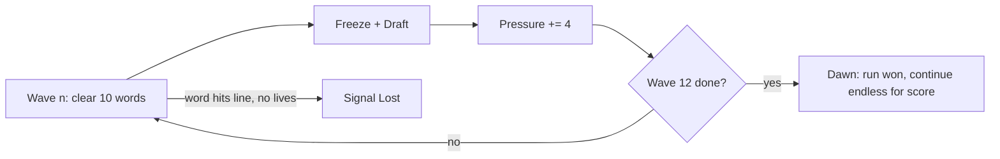

# Wordfall: Design Spec (v2)

A one-screen typing game with a draft-only roguelite layer. No map, no branches.

Status: **M1–M5 implemented**, presented as a Windows 95-era desktop application (browser
and native Windows build). M5 numbers, tuning notes and deviations are in §9.

## 1. Pillar

> **Read. Commit. Survive.** You may only type the word closest to the ground.

Every card bends exactly one of three things:
- **The rule:** which words you're allowed to type (Wide Scope, Overclock)
- **The reading:** how words look (Reverse, Tunnel, Ghost, Decoy)
- **The economy:** score, speed, survival (Greed, Ledger, Grace, Slow Drift)

If a proposed card doesn't bend one of these, cut it.

## 2. Run structure



- **Wave** = 10 clears. The draft opens when a wave ends. The board freezes, and words keep their positions.
- **Pressure** is the one difficulty variable: `pressure = cleared + 4 x draftsTaken`.
  - `wordRange`, `spawnInterval` and `speed` all read `pressure` instead of `cleared`. (Small code change: swap one input.)
  - Skip still counts as a draft taken. You can't dodge escalation by skipping.
- **Dawn:** finishing wave 12 wins the run. Play continues in endless mode with a score-only goal. Without this, the game has no ending.
- **Target run length:** 8 to 12 minutes for a 60 WPM player.

## 3. Scoring

```
points = letters x (10 + ledger) x comboMult x heatMult
comboMult = 1 + 0.05 x min(combo, 20)      // unchanged, max 2.0x
heatMult  = 1 + 0.25 x heat                // heat = number of Hexes held (+ tier II counts twice)
```

- Combo carries through the draft pause (resolves Q2).
- Combo resets on a wrong key or a word hitting the line. Word progress is kept after a wrong key (M1 rule, revisit in M5).

## 4. Mechanical primitives

Cards may only use these. If a card needs something new, add it here first.

| Primitive | Definition |
| --- | --- |
| **Life** | Word hits the line: lose 1. At 0 the run ends. Start: 1. |
| **Shield** | Takes the hit from one wrong key: combo kept, no flash. Refills when a wave starts. |
| **Heat** | Count of Hexes held. Feeds `heatMult`. Never goes down. |
| **Target set** | The words you're allowed to type. Default: the lowest one. |
| **Lock-on** | When the target set holds more than 1 word, the first correct letter locks onto one word (ties go to the lowest). The lock holds until that word is cleared. |
| **Pressure** | See §2. |

## 5. Cards

### 5.1 Draft rules

- 3 cards. Slot 1 = **Boon**, slot 2 = any type, slot 3 = **Hex or Gambit**. No duplicates within one draft.
- **Reroll:** 1 per run. **Skip:** +50 x wave points.
- Rarity: common 75% / rare 25%, rolled per slot.
- Repeat pick: upgrades to tier II if the card has one. Otherwise the card leaves the pool after the first pick.
- Slot exhaustion: if every card of a slot's type is ineligible, that slot falls back to any other eligible card so the draft still shows three cards. If the whole pool is exhausted the slot is empty (only Skip is available).
- Auto-clears (**Overclock**) score and count toward Pressure, but do not count toward a wave: a wave is exactly ten player clears.

### 5.2 Card list (12)

| Card | Type | Rarity | Effect | Tier II |
| --- | --- | --- | --- | --- |
| **Wide Scope** | Boon | rare | The target set includes the 2nd lowest word (uses lock-on) | 3rd lowest too |
| **Overclock** | Boon | rare | Every 5th clear auto-clears the next target. Auto-clears give points but no combo | Every 4th |
| **Grace** | Boon | common | +1 Life | none |
| **Steady Hand** | Boon | common | +1 Shield | +2 Shields |
| **Slow Drift** | Boon | common | Fall speed x0.85 | x0.75 |
| **Greed** | Gambit | common | Score x1.3, fall speed x1.1 | x1.6 / x1.2 |
| **Longshot** | Gambit | rare | 7+ letter words score x2 and fall 20% faster | none |
| **Ledger** | Gambit | common | +2 points per letter, word-length bucket counts as +8 Pressure | none |
| **Reverse** | Hex | common | Type the target word right to left | none |
| **Tunnel** | Hex | common | Only the next 3 letters of the target (in typing order) are visible | Next 2 |
| **Ghost** | Hex | common | Each cleared word leaves an inert echo in place for 3 s | none |
| **Decoy** | Hex | rare | 1 in 8 spawns is a misspelled fake that drops 4.5× faster. While a fake is the lowest word, every key counts as a mistake. Fakes fall through the line harmlessly | 1 in 5 |

**Cut to backlog:** Split (§8.1, Q3). It breaks the spawn queue and lock-on, and nothing in this list depends on it.

### 5.3 Card interactions (defined up front)

- **Reverse + Tunnel:** Tunnel counts in typing order, so it shows the rightmost unrevealed letters. The two stack.
- **Reverse + Wide Scope:** lock-on uses the word's *first letter in typing order*.
- **Decoy + Wide Scope:** a fake in the target set doesn't block if a real word in the set can be locked.
- **Overclock + Decoy:** auto-clear skips fakes.
- **Greed + Slow Drift:** speed multipliers multiply together.

### 5.4 Eligibility filter (no dead picks)

| Card | Offered only when |
| --- | --- |
| Longshot | the current word range includes 7+ letter words |
| Wide Scope II | Wide Scope I is held |
| Grace | lives held < 3 |
| Steady Hand | shields held < 3 |
| Any Hex | the player doesn't already hold all 4 |

## 6. Decisions log

| Decision | Status |
| --- | --- |
| Canvas, single page, no build step, monospace | **Superseded** — gameplay is still a canvas playfield, but the shell is a Windows 95-style DOM/CSS application (title bar, menus, status bar, dialogs). The web version still has no build step; the native Windows build (§9) adds a .NET shell. |
| No map, draft-only roguelite | Kept |
| No backspace | Kept |
| Wrong key keeps word progress | Kept. First thing to revisit in M5 |
| Draft trigger = waves of 10 clears | **New** (resolves Q1) |
| Combo carries through the draft | **New** (resolves Q2) |
| Split goes to the backlog | **New** (resolves Q3) |
| Keyboard only, no touch | Kept (Q4 closed) |
| Dawn win state at wave 12 | **New** |
| Win95-era presentation, browser + native | **New** (§9) |

## 7. Milestones (with acceptance criteria)

| Milestone | Scope | Done when | Status |
| --- | --- | --- | --- |
| **M2 Draft + Pressure** | `draft` phase, wave counter, `pressure` replaces `cleared` in the ramps, 3 starter cards: **Slow Drift** (Boon), **Greed** (Gambit), **Reverse** (Hex), plus Heat in scoring/HUD, Skip, Reroll, keys 1/2/3/R/S | Smoke test: clearing 10 words enters `draft`, picking resumes play with combo kept, pressure +4, and Heat changes the score | **Done** |
| **M3 Card set** | Remaining 9 cards, primitives (Shield, Lock-on), eligibility filter, tier II | Smoke test per card through `__wordfall` (force a pick, assert the effect). No card offered while ineligible across 1000 seeded drafts | **Done** |
| **M4 Feel** | Hit-pause on clear, particles, combo pitch rise, near-miss shake, danger-line audio, card rise animation | Manual playtest checklist. 60 fps held with 12 words + Ghost echoes | **Done** |
| **M5 Tuning** | Headless bot at 40/60/80 WPM with random picks, plus a word pool of 400+ words | 60 WPM bot, no cards: dies at wave 5 to 7. 60 WPM with picks: reaches Dawn in 30 to 50% of runs. 80 WPM: over 70% | **Done** |

## 8. Backlog / open questions

1. **Split:** prototype after M5 if the card pool feels thin.
2. **Meta progression** (unlocking cards between runs): out of scope until after M5.
3. **Word pool:** **Resolved in M5** — 459 words in `words.js`, 38 of them 10–11 letters.

## 9. Implementation notes (M5)

What shipped vs. this doc, and the numbers that back the M5 "Done when" column.

**Measured (400 bot runs per cell, seed block 1000–1399, `node tools/bot.mjs --seeds 400`)**

| Cell | Result | Target |
| --- | --- | --- |
| 60 WPM, no cards (`skip`) | dies 400/400 (100%); median wave 6, mean 6.24; `{5:4, 6:299, 7:93, 8:4}` | dies at wave 5–7 |
| 60 WPM, random picks | Dawn 34.8% (139/400) | Dawn 30–50% |
| 80 WPM, random picks | Dawn 100% (400/400) | Dawn > 70% |

The default 100-seed run used by the bot's assertions gives median 6, 33% and 100%.

Run-to-run seed blocks vary by a few points; the shipped curve sits mid-band on purpose.

**Deviations from the letter of the doc**

- **Decoy fakes drop faster.** The card table never pinned how fast a fake falls, and
  at normal fall speed a single fake blocked the target for a whole fall (10–20 s), which
  made a picked Decoy an automatic loss and kept random-pick runs far below the M5 Dawn
  targets. Fakes now fall at `CFG.fakeSpeedMult = 4.5×`; the misspelled-fake rule is
  unchanged.
- **Run length.** Target §2 says 8–12 minutes for a 60 WPM player. The bot's winning runs
  average ~4.2 minutes (4.0–4.7 min): reaching wave 12 requires the spawn rate and fall
  speed to stay threatening, and those same two values make clears fast. Human runs are
  longer because of draft reading and imperfect play, but the gap is real.
- **Tuning lives entirely in `CFG`** (see README §Tuning), including `wordRangeSteps`
  and `fakeSpeedMult`. Any change to the curve should be checked with `tools/bot.mjs`.
- **Deterministic sim seeding.** `setSeed()` hashes the seed before feeding the PRNG
  (splitmix32-style), otherwise adjacent seeds were correlated enough to bias bot sweeps
  by ±20 points on Dawn rate. Normal play seeds from the clock, so this only affects the
  headless bot.
- **Pressure scale.** The old M1 ramp (`speedPerClear 1.9`, `spawnMin 0.8`, range
  up to `[5,11]`) was far too steep once Pressure added 4 per draft; M5 retuned it to
  `speedPerClear 0.354`, `maxSpeed 45`, `spawnMin 1.05`, and a `[6,10]` late word range.
- **Faster fall after playtest.** The first M5 build felt sluggish ("words fall too
  slow"): crossing took ~38 s at wave 1 and ~18.6 s at max pressure. The shipped curve
  doubles it to `baseSpeed 52` / `maxSpeed 95` / `speedPerClear 0.662`, i.e. ~16 s and
  ~8.8 s, with `maxWords` halved to 6 and `spawnMin` raised to 1.25 s so the smaller,
  faster queue preserves the same survival margins. M5 numbers above are from that build.

**Presentation (Windows 95-era)**

- The shell is a Win95 application: teal desktop with icons and taskbar in the browser
  build, borderless native window with the same chrome in the native build. Real DOM/CSS
  elements (title bar, menu bar, toolbar, status bar, Start menu, modal dialogs), not
  canvas imitations: Win95 grey, 2px bevels, Tahoma / Microsoft Sans Serif.
- The playfield is a 16-colour canvas: ordered-dither sky, 2×2 pixel skyline windows,
  Lucida Console words, square particles, dotted target brackets.
- The rules run in a **fixed 800-unit-tall logical playfield**, uniformly scaled to the
  client area. This keeps fall times — and therefore difficulty — identical at any window
  size; the bot's M5 numbers are the same in a 1024×768 window and a maximised 1080p one.
- Native build: `win/` is a .NET 10 WinForms + WebView2 shell. It embeds `index.html`,
  `style.css`, `words.js`, `game.js` as resources and serves them from
  `https://wordfall.local/` in memory (so `localStorage` works), then removes the real
  title bar: the page's title bar drags the window and its buttons post
  `drag`/`min`/`max`/`close` to the host. Build with `win/build.ps1 -Smoke`; output is
  `dist/Wordfall-win64/Wordfall.exe`.

