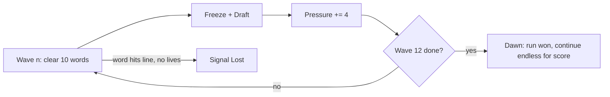

# Wordfall: Design Spec (v2.1)

A one-screen typing game with a draft-only roguelite layer. No map, no branches.

Status: **M1–M6 implemented**, shipped as v1.1, presented as a Windows 95-era desktop
application (browser and native Windows build). M5 numbers, tuning notes and deviations
are in §9; the M6 additions and their measured numbers are in §10.

## 1. Pillar

> **Read. Commit. Survive.** You may only type the word closest to the ground.

Every card bends exactly one of three things:
- **The rule:** which words you're allowed to type (Wide Scope, Overclock)
- **The reading:** how words look (Reverse, Tunnel, Ghost, Decoy)
- **The economy:** score, speed, survival (Greed, Ledger, Grace, Slow Drift)

If a proposed card doesn't bend one of these, cut it.

## 2. Run structure



- **Wave** = 10 clears. The draft opens when a wave ends. The board freezes, and words keep their positions.
- **Pressure** is the one difficulty variable: `pressure = cleared + 4 x draftsTaken`.
  - `wordRange`, `spawnInterval` and `speed` all read `pressure` instead of `cleared`. (Small code change: swap one input.)
  - Skip still counts as a draft taken. You can't dodge escalation by skipping.
- **Dawn:** finishing wave 12 wins the run. Play continues in endless mode with a score-only goal. Without this, the game has no ending.
- **Target run length:** 8 to 12 minutes for a 60 WPM player.

### 2.1 Pause, records, seeds and run stats (M6)

- **Pause is a phase** (`paused`). `Esc` while playing pauses; `Esc` or `Enter` resumes, and
  Game → Pause/Resume is the mouse path. Printable letters always type — a typing game
  cannot spend a letter on a hotkey. The board and the *playing-time* clock freeze while
  paused; the pause dialog shows `Seed N · MM:SS played`. Minimize auto-pauses, and restore
  resumes only that minimize-induced pause, never a pause the player asked for.
- **Run stats:** each run tracks correct letters, wrong keys (shield-eaten wrong keys
  included), seconds spent in the `playing` phase, and its seed. The game-over and Dawn
  dialogs show
  `wave · words cleared · best combo · WPM · accuracy% · MM:SS · Seed N`.
  WPM = correct letters / 5 per minute of playing time; accuracy = correct /
  (correct + wrong keys). **Retry Seed** on the game-over dialog starts a new run on the
  same seed.
- **Records** are lifetime and per machine: `{runs, dawns, bestScore, bestWave,
  bestCombo, words, fastestDawnSec}` in `localStorage` key `wordfall.records`, written
  exactly once when a run ends (game over or Dawn), and migrated from the old
  `wordfall.best` key. Game → Records… shows them; the welcome dialog keeps showing the
  record best score. Headless tuning sweeps do not touch the record book.
- **Settings:** `wordfall.settings` (`{muted}`) persists the sound toggle.
- **Seeded runs:** `reset(seed?)` seeds the PRNG deterministically, so a seed reproduces
  the same run. The headless bot drives runs through the same path.

## 3. Scoring

```
points = letters x (10 + ledger) x comboMult x heatMult
comboMult = 1 + 0.05 x min(combo, 20)      // unchanged, max 2.0x
heatMult  = 1 + 0.25 x heat                // heat = number of Hexes held (+ tier II counts twice)
```

- Combo carries through the draft pause (resolves Q2).
- Combo resets on a wrong key or a word hitting the line. Word progress is kept after a wrong key (M1 rule, revisit in M5).

## 4. Mechanical primitives

Cards may only use these. If a card needs something new, add it here first.

| Primitive | Definition |
| --- | --- |
| **Life** | Word hits the line: lose 1. At 0 the run ends. Start: 1. |
| **Shield** | Takes the hit from one wrong key: combo kept, no flash. Refills when a wave starts. |
| **Heat** | Count of Hexes held. Feeds `heatMult`. Never goes down. |
| **Target set** | The words you're allowed to type. Default: the lowest one. |
| **Lock-on** | When the target set holds more than 1 word, the first correct letter locks onto one word (ties go to the lowest). The lock holds until that word is cleared. |
| **Pressure** | See §2. |

## 5. Cards

### 5.1 Draft rules

- 3 cards. Slot 1 = **Boon**, slot 2 = any type, slot 3 = **Hex or Gambit**. No duplicates within one draft.
- **Reroll:** 1 per run. **Skip:** +50 x wave points.
- Rarity: common 75% / rare 25%, rolled per slot.
- Repeat pick: upgrades to tier II if the card has one. Otherwise the card leaves the pool after the first pick.
- Slot exhaustion: if every card of a slot's type is ineligible, that slot falls back to any other eligible card so the draft still shows three cards. If the whole pool is exhausted the slot is empty (only Skip is available).
- Auto-clears (**Overclock**) score and count toward Pressure, but do not count toward a wave: a wave is exactly ten player clears.

### 5.2 Card list (13)

| Card | Type | Rarity | Effect | Tier II |
| --- | --- | --- | --- | --- |
| **Wide Scope** | Boon | rare | The target set includes the 2nd lowest word (uses lock-on) | 3rd lowest too |
| **Overclock** | Boon | rare | Every 5th clear auto-clears the next target. Auto-clears give points but no combo | Every 4th |
| **Grace** | Boon | common | +1 Life | none |
| **Steady Hand** | Boon | common | +1 Shield | +2 Shields |
| **Slow Drift** | Boon | common | Fall speed x0.85 | x0.75 |
| **Greed** | Gambit | common | Score x1.3, fall speed x1.1 | x1.6 / x1.2 |
| **Longshot** | Gambit | rare | 7+ letter words score x2 and fall 20% faster | none |
| **Ledger** | Gambit | common | +2 points per letter, word-length bucket counts as +8 Pressure | none |
| **Reverse** | Hex | common | Type the target word right to left | none |
| **Tunnel** | Hex | common | Only the next 3 letters of the target (in typing order) are visible | Next 2 |
| **Ghost** | Hex | common | Each cleared word leaves an inert echo in place for 3 s | none |
| **Decoy** | Hex | rare | 1 in 8 spawns is a misspelled fake that drops 4.5× faster. While a fake is the lowest word, every key counts as a mistake. Fakes fall through the line harmlessly | 1 in 5 |
| **Split** | Hex | common | Every 5th spawn also drops a free word. It is a real 3–5 letter word: it scores and counts toward the wave, blocks the words above it while it falls, and costs no life at the line. It spawns even when the queue is full (the Hex's cost) | Every 3rd spawn |

**Split was promoted from the backlog in M6:** it is the fifth Hex and the 13th card, so
the "all Hexes held" eligibility rule now covers all five. The free word carries
`word.harmless === true`, renders teal (`COL.splitWord = '#00a0a0'`) with a dotted marker
above it (fakes are marked below), and is never a fake. Its cadence lives in
`splitEvery()` (5th spawn at tier I, 3rd at tier II), not in `CFG`.

### 5.3 Card interactions (defined up front)

- **Reverse + Tunnel:** Tunnel counts in typing order, so it shows the rightmost unrevealed letters. The two stack.
- **Reverse + Wide Scope:** lock-on uses the word's *first letter in typing order*.
- **Decoy + Wide Scope:** a fake in the target set doesn't block if a real word in the set can be locked.
- **Overclock + Decoy:** auto-clear skips fakes.
- **Greed + Slow Drift:** speed multipliers multiply together.

### 5.4 Eligibility filter (no dead picks)

| Card | Offered only when |
| --- | --- |
| Longshot | the current word range includes 7+ letter words |
| Wide Scope II | Wide Scope I is held |
| Grace | lives held < 3 |
| Steady Hand | shields held < 3 |
| Any Hex | the player doesn't already hold all 5 |

The Hex rule is generic: it reads the number of Hex cards in `CARD_LIST` (exported as
`window.__wordfall.hexTotal`), so it stays correct as the pool grows — M6 added Split and
the check moved from 4 to 5 without a hard-coded list.

## 6. Decisions log

| Decision | Status |
| --- | --- |
| Canvas, single page, no build step, monospace | **Superseded** — gameplay is still a canvas playfield, but the shell is a Windows 95-style DOM/CSS application (title bar, menus, status bar, dialogs). The web version still has no build step; the native Windows build (§9) adds a .NET shell. |
| No map, draft-only roguelite | Kept |
| No backspace | Kept |
| Wrong key keeps word progress | Kept. First thing to revisit in M5 |
| Draft trigger = waves of 10 clears | **New** (resolves Q1) |
| Combo carries through the draft | **New** (resolves Q2) |
| Split goes to the backlog | **Resolved in M6** — promoted as the 13th card, Hex / common (§5.2) |
| Keyboard only, no touch | Kept (Q4 closed) |
| Dawn win state at wave 12 | **New** |
| Win95-era presentation, browser + native | **New** (§9) |
| Pause is a real phase; Esc pauses, Esc/Enter resumes | **New (M6)** — no letter is spent on a hotkey; the run clock freezes (§2.1) |
| Lifetime records in localStorage, per machine | **New (M6)** — `wordfall.records`; no accounts, no network (§2.1) |
| Runs carry a visible seed and can be retried | **New (M6)** — seed on pause/game-over/Dawn; Retry Seed replays it (§2.1) |
| Sound setting persists across launches | **New (M6)** — `wordfall.settings` (§2.1) |

## 7. Milestones (with acceptance criteria)

| Milestone | Scope | Done when | Status |
| --- | --- | --- | --- |
| **M2 Draft + Pressure** | `draft` phase, wave counter, `pressure` replaces `cleared` in the ramps, 3 starter cards: **Slow Drift** (Boon), **Greed** (Gambit), **Reverse** (Hex), plus Heat in scoring/HUD, Skip, Reroll, keys 1/2/3/R/S | Smoke test: clearing 10 words enters `draft`, picking resumes play with combo kept, pressure +4, and Heat changes the score | **Done** |
| **M3 Card set** | Remaining 9 cards, primitives (Shield, Lock-on), eligibility filter, tier II | Smoke test per card through `__wordfall` (force a pick, assert the effect). No card offered while ineligible across 1000 seeded drafts | **Done** |
| **M4 Feel** | Hit-pause on clear, particles, combo pitch rise, near-miss shake, danger-line audio, card rise animation | Manual playtest checklist. 60 fps held with 12 words + Ghost echoes | **Done** |
| **M5 Tuning** | Headless bot at 40/60/80 WPM with random picks, plus a word pool of 400+ words | 60 WPM bot, no cards: dies at wave 5 to 7. 60 WPM with picks: reaches Dawn in 30 to 50% of runs. 80 WPM: over 70% | **Done** |
| **M6 Pause + records + run identity + Split** | `paused` phase and dialog, lifetime Records, WPM/accuracy/run-time/seed stats on game-over and Dawn, Retry Seed, settings persistence, 13th card Split | Smoke test: pause freezes board and clock and resumes via Esc/Enter; records load and save once per finished run; `reset(seed)` is deterministic; the result dialogs carry WPM/accuracy/time/seed; Retry Seed replays the seed; Split spawns a real harmless 3–5 letter word on its cadence and is the fifth Hex. Bot: all M5 cells still pass at 400 seeds | **Done** |

## 8. Backlog / open questions

1. **Split:** **Resolved in M6** — promoted as the 13th card, Hex / common, tier I every
   5th spawn, tier II every 3rd (§5.2). The measured impact is in §10.
2. **Meta progression** (unlocking cards between runs): out of scope until after M5.
3. **Word pool:** **Resolved in M5** — 459 words in `words.js`, 38 of them 10–11 letters.

## 9. Implementation notes (M5)

What shipped vs. this doc, and the numbers that back the M5 "Done when" column.

**Measured (400 bot runs per cell, seed block 1000–1399, `node tools/bot.mjs --seeds 400`)**

| Cell | Result | Target |
| --- | --- | --- |
| 60 WPM, no cards (`skip`) | dies 400/400 (100%); median wave 6, mean 6.24; `{5:4, 6:299, 7:93, 8:4}` | dies at wave 5–7 |
| 60 WPM, random picks | Dawn 34.8% (139/400) | Dawn 30–50% |
| 80 WPM, random picks | Dawn 100% (400/400) | Dawn > 70% |

The default 100-seed run used by the bot's assertions gives median 6, 33% and 100% on the
M5 build; the M6 re-measure is in §10.

Run-to-run seed blocks vary by a few points; the shipped curve sits mid-band on purpose.

**Deviations from the letter of the doc**

- **Decoy fakes drop faster.** The card table never pinned how fast a fake falls, and
  at normal fall speed a single fake blocked the target for a whole fall (10–20 s), which
  made a picked Decoy an automatic loss and kept random-pick runs far below the M5 Dawn
  targets. Fakes now fall at `CFG.fakeSpeedMult = 4.5×`; the misspelled-fake rule is
  unchanged.
- **Run length.** Target §2 says 8–12 minutes for a 60 WPM player. The bot's winning runs
  average ~4.2 minutes (4.0–4.7 min): reaching wave 12 requires the spawn rate and fall
  speed to stay threatening, and those same two values make clears fast. Human runs are
  longer because of draft reading and imperfect play, but the gap is real.
- **Tuning lives entirely in `CFG`** (see README §Tuning), including `wordRangeSteps`
  and `fakeSpeedMult`. Any change to the curve should be checked with `tools/bot.mjs`.
- **Deterministic sim seeding.** `setSeed()` hashes the seed before feeding the PRNG
  (splitmix32-style), otherwise adjacent seeds were correlated enough to bias bot sweeps
  by ±20 points on Dawn rate. Normal play seeds from the clock, so this only affects the
  headless bot.
- **Pressure scale.** The old M1 ramp (`speedPerClear 1.9`, `spawnMin 0.8`, range
  up to `[5,11]`) was far too steep once Pressure added 4 per draft; M5 retuned it to
  `speedPerClear 0.354`, `maxSpeed 45`, `spawnMin 1.05`, and a `[6,10]` late word range.
- **Faster fall after playtest.** The first M5 build felt sluggish ("words fall too
  slow"): crossing took ~38 s at wave 1 and ~18.6 s at max pressure. The shipped curve
  doubles it to `baseSpeed 52` / `maxSpeed 95` / `speedPerClear 0.662`, i.e. ~16 s and
  ~8.8 s, with `maxWords` halved to 6 and `spawnMin` raised to 1.25 s so the smaller,
  faster queue preserves the same survival margins. M5 numbers above are from that build.

**Presentation (Windows 95-era)**

- The shell is a Win95 application: teal desktop with icons and taskbar in the browser
  build, borderless native window with the same chrome in the native build. Real DOM/CSS
  elements (title bar, menu bar, toolbar, status bar, Start menu, modal dialogs), not
  canvas imitations: Win95 grey, 2px bevels, Tahoma / Microsoft Sans Serif.
- The playfield is a 16-colour canvas: ordered-dither sky, 2×2 pixel skyline windows,
  Lucida Console words, square particles, dotted target brackets.
- The rules run in a **fixed 800-unit-tall logical playfield**, uniformly scaled to the
  client area. This keeps fall times — and therefore difficulty — identical at any window
  size; the bot's M5 numbers are the same in a 1024×768 window and a maximised 1080p one.
- Native build: `win/` is a .NET 10 WinForms + WebView2 shell. It embeds `index.html`,
  `style.css`, `words.js`, `game.js` as resources and serves them from
  `https://wordfall.local/` in memory (so `localStorage` works), then removes the real
  title bar: the page's title bar drags the window and its buttons post
  `drag`/`min`/`max`/`close` to the host. Build with `win/build.ps1 -Smoke`; output is
  `dist/Wordfall-win64/Wordfall.exe`.

## 10. Implementation notes (M6 / v1.1)

What shipped against §2.1, §5.2 and the M6 milestone, and the numbers behind it. The
independent M6 acceptance review is [QA-REPORT-M6.md](QA-REPORT-M6.md); the v1.0 review
`QA-REPORT.md` is kept as a historical record and was not rewritten.

**Measured on the shipped M6 build** (my own fresh runs; the same commands and seed blocks
as §9, not numbers carried over from M5):

| Cell | 400 seeds (block 1000–1399) | 100 seeds | Target | Result |
| --- | --- | --- | --- | --- |
| 60 WPM, no cards (`skip`) | dies 400/400; median 6, mean 6.24, `{5:4, 6:299, 7:93, 8:4}` | dies 100/100; median 6, `{6:78, 7:21, 8:1}` | dies at wave 5–7 | **PASS** |
| 60 WPM, random picks | Dawn **37.3%** (149/400) | Dawn **40.0%** (40/100) | Dawn 30–50% | **PASS** |
| 80 WPM, random picks | Dawn **98.8%** (395/400) | Dawn **99.0%** (99/100) | Dawn > 70% | **PASS** |

`node tools/smoke.mjs` on the same build: **133/133 checks pass, 0 page/console errors,
≈22 s**. It covers pause (board and playing clock frozen, Escape/Enter resume), records
(localStorage round-trip and save-once-per-run), deterministic `reset(seed)` and Retry
Seed, the WPM/accuracy/time/seed result line, and Split (real short harmless word on the
5th/3rd-spawn cadence, typeable and scoring, no life at the line, bypasses `maxWords`,
never fake). The eligibility sweep re-checks 1050 seeded drafts with 0 violations.

**Pause.** A real `paused` phase. Escape is the only pause key; Escape or Enter resumes;
printable letters are swallowed while paused (P is a letter, not a resume key). The pause
dialog shows `Seed N · MM:SS played`, offers Resume (default), Restart Run and Controls…,
and opening Controls/About from it returns to the pause dialog. Game → Pause/Resume keeps
the Esc shortcut span and switches its label. `state.runSec` only advances in the
`playing` phase. Minimize auto-pauses; restore resumes only that minimize-induced pause,
not a user pause. Modal-open title-bar buttons are visually inert.

**Records.** `wordfall.records` holds `{runs, dawns, bestScore, bestWave, bestCombo, words,
fastestDawnSec}`, defaults 0, migrated from `wordfall.best`. `recordRun(won)` is called
exactly once per finished run (game over or Dawn), guarded by `runRecorded`, and is skipped
while `state.simulating` so bot sweeps never write the player's record book.
`wordfall.best` is still mirrored for compatibility; the welcome/About best score reads
`records.bestScore`. The dialog lives in the Game menu only.

**Split.** The free word is drawn from the real pool at 3–5 letters via
`pickSpawnText(3, 5)`; it is not a fake. It is typeable, scores like a normal clear and
counts toward the wave; it carries `word.harmless = true` so reaching the line costs no
life, and it is staged above the queue so while it falls it blocks the words above it —
that lost reading time is the Hex's cost. It deliberately ignores `maxWords`, so the card
bites even at a full queue. Teal (`COL.splitWord = '#00a0a0'`) with a dotted marker above
the word (fake markers stay below). Tier I every 5th spawn, tier II every 3rd, driven by
`state.spawnCount`; never faked. Hex eligibility is generic over `CARD_LIST`
(`HEX_TOTAL`, exposed as `__wordfall.hexTotal`), so the rule moved from four Hexes to five
without a hard-coded list.

**Settings.** `wordfall.settings` stores `{muted}`, loaded at boot and written on every
sound toggle; the menu label and toolbar button reflect it.

**Deviation / notes.** No `CFG` tuning changed for M6 — the cards changed the random-pick
mix, which moved the 60/random rate from 34.8% (M5) to 37.3% and 80/random from 100% to
98.8%; both remain inside their M5 bands. Run length is unchanged (an 80 WPM bot run
reaches Dawn in ~224 s, 3.7 min mean over 400 seeds). The native shell was rebuilt after
the web freeze: the published `dist\Wordfall-win64\` passes its own `--smoke` as
`version:"M6"` / `embeddedMode:true` and embeds the frozen web files (`Wordfall.dll`
contains the M6 strings). `dist/` is gitignored and regenerated, so a GitHub release must
attach the built folder rather than rely on the repo.

